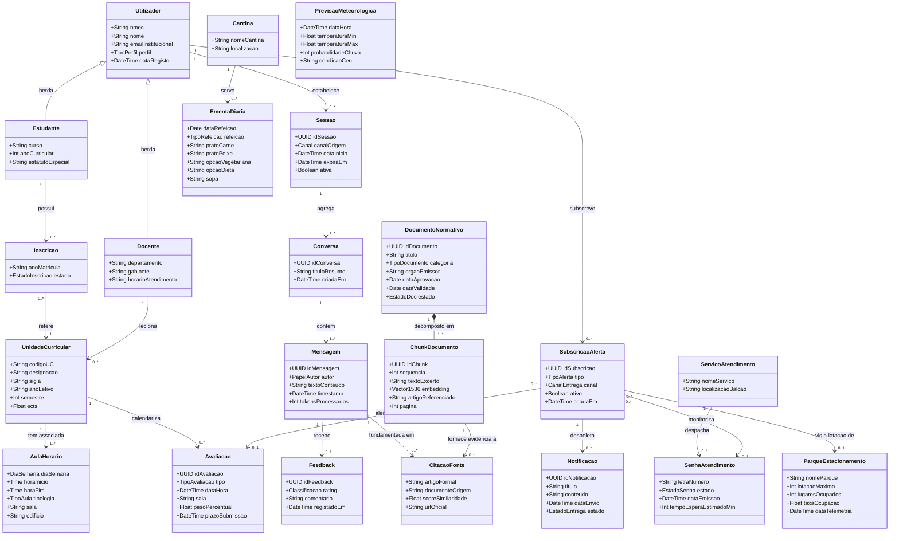

# DetiBuddy — Modelo de Domínio Conceptual (*Domain Model*)
## Engenharia de Software — Fase de Elaboração (Milestone 2)

---

### 1. Enquadramento e Propósito Metodológico

O **Modelo de Domínio Conceptual** (*Domain Model*) representa as classes conceptuais, entidades de negócio, atributos intrínsecos e associações estruturais que compõem o universo de discurso do assistente conversacional **DetiBuddy**.

Em consonância com as boas práticas de Engenharia de Software e o padrão *Agile Modeling (UML)*, este modelo:
1. **Foca-se no Espaço do Problema:** Modela conceitos do mundo real e da vida universitária (estudantes, docentes, unidades curriculares, regulamentos, ementas, parques, senhas e conversas), abstraindo detalhes de implementação como métodos ou *frameworks*.
2. **Assegura Rastreabilidade:** Serve de ponte concetual entre os requisitos funcionais (**FR**), as histórias de utilizador (**US**), os 22 casos de uso (**UC**) e a arquitetura física e de persistência (**Arquitetura v2** em PostgreSQL, pgvector e Redis).
3. **Consagra a Soberania e RGPD:** Modela explicitamente o ciclo de vida e efemeridade dos dados do estudante, os canais de proveniência e a fundamentação estrita de citações regulamentares.

---

### 2. Diagrama de Classes Conceptuais (UML)

---

### 3. Decomposição Estruturada por Aglomerados (*Clusters*)

#### 3.1 Cluster 1: Identidade, Sessão e Interação Conversacional
Modela o acesso seguro, a auditoria de conversas e o respeito pelos direitos RGPD de privacidade.
* **`Utilizador`:** Entidade central representativa de qualquer indivíduo com conta institucional na UA (ou perfil visitante). Define atributos como `nmec`, `nome`, `emailInstitucional` e `perfil` (`ESTUDANTE`, `DOCENTE`, `ADMINISTRADOR`, `VISITANTE`).
* **`Estudante` / `Docente`:** Especializações de `Utilizador` que enriquecem o contexto conversacional com dados específicos de curso/ano ou gabinete/horário de atendimento.
* **`Sessao`:** Intervalo temporal de interação delimitado, associado a um canal (`REACT_PWA`, `DISCORD`) e gerido em memória volátil (Redis).
* **`Conversa`:** Fio condutor de diálogo temático (*thread*) criado no âmbito de uma sessão.
* **`Mensagem`:** Intercâmbio atómico de texto emitido pelo utilizador ou gerado pelo assistente via streaming SSE. Guarda tokens gastos e *timestamp*.
* **`Feedback`:** Avaliação qualitativa opcional do utilizador (`rating`: positivo/negativo e comentário opcional), garantindo o requisito de avaliação contínua (US-35).

#### 3.2 Cluster 2: Conhecimento Institucional e Base Vetorial (RAG)
Modela o suporte documental normativo para respostas fundamentadas e sem alucinações (NFR-03, NFR-11).
* **`DocumentoNormativo`:** Regulamentos pedagógicos, calendários escolares ou despachos em formato PDF carregados pelo administrador (ex.: Regulamento de Avaliação Discente da UA). Inclui metadados de ciclo de vida (`dataValidade`, `estado: VIGENTE | REVOGADO`).
* **`ChunkDocumento`:** Segmento textual atomizado com sobreposição (*overlap*), associado ao respetivo vetor de *embeddings* (1536 ou 384 dimensões no `pgvector`) e referência precisa ao artigo e página de proveniência.
* **`CitacaoFonte`:** Rastreabilidade formal incorporada na mensagem de resposta, assegurando transparência perante o estudante.

#### 3.3 Cluster 3: Domínio Académico e Pedagógico (PACO & Moodle)
Modela o currículo do estudante e o seu dia a dia letivo.
* **`UnidadeCurricular`:** Disciplina ativa (código oficial, sigla, ano letivo, semestre e créditos ECTS).
* **`Inscricao`:** Vínculo formal do estudante a uma determinada UC num dado ano letivo.
* **`AulaHorario`:** Bloco semanal de aulas com tipologia definida (`T`, `TP`, `PL`), docente responsável, sala e pavilhão no campus.
* **`Avaliacao`:** Marco formal de avaliação letiva (teste intercalar, exame, entrega de trabalho ou projeto), com indicação de sala e peso percentual na nota final.

#### 3.4 Cluster 4: Serviços de Campus, Logística e Telemetria (SAS, Parques, Senhas, IPMA)
Modela os serviços utilitários de suporte à vida física no campus de Santiago.
* **`Cantina` & `EmentaDiaria`:** Refeitórios SAS da UA (Central, Crasto, Santiago) e detalhe das refeições do dia (pratos de carne, peixe, vegetariano, dieta, sopa e alergénios).
* **`ParqueEstacionamento`:** Parque do campus com informação em tempo quase-real da sua lotação (lugares ocupados, taxa de ocupação percentual e hora da última leitura).
* **`ServicoAtendimento` & `SenhaAtendimento`:** Balcões de atendimento presencial e senhas emitidas, com estado corrente (`EM_ESPERA`, `A_CHAMAR`) e estimativa de tempo restante.
* **`PrevisaoMeteorologica`:** Telemetria atmosférica oficial do IPMA para o concelho de Aveiro (temperatura, precipitação e aviso meteorológico).

#### 3.5 Cluster 5: Alertas Proativos e Gestão de Tarefas
Modela o motor assíncrono de notificações proativas executado pelo **Worker ARQ**.
* **`SubscricaoAlerta`:** Registo explícito de interesse do estudante em ser notificado quando determinada condição de negócio se verificar (ex.: senha próxima do atendimento, aproximação da data limite de teste ou existência de vagas no parque favorito).
* **`Notificacao`:** Registo da mensagem enviada e despachada para o cliente (via notificação PWA ou email de contingência), com confirmação de entrega.

---

### 4. Dicionário de Classes e Multiplicidades

| Classe Conceptual | Descrição de Negócio | Entidades Associadas | Multiplicidade e Regra |
| :--- | :--- | :--- | :--- |
| **`Utilizador`** | Indivíduo ou ator no ecossistema da UA | `Sessao`, `SubscricaoAlerta` | $1 \rightarrow 0..*$ (um utilizador pode abrir múltiplas sessões e ter múltiplos alertas) |
| **`Sessao`** | Sessão de autenticação ou navegação | `Conversa` | $1 \rightarrow 1..*$ (uma sessão agrega pelo menos uma conversa) |
| **`Conversa`** | Histórico ordenado de perguntas/respostas | `Mensagem` | $1 \rightarrow 1..*$ (uma conversa é composta por mensagens sequenciais) |
| **`Mensagem`** | Expressão conversacional com metadados | `Feedback`, `CitacaoFonte` | $1 \rightarrow 0..1$ (feedback opcional); $1 \rightarrow 0..*$ (citações RAG) |
| **`DocumentoNormativo`**| Regulamento ou documento oficial da UA | `ChunkDocumento` | $1 \rightarrow 1..*$ (*composição estrita*: destruição do doc purga chunks) |
| **`UnidadeCurricular`** | Disciplina curricular do plano de estudos | `AulaHorario`, `Avaliacao` | $1 \rightarrow 1..*$ (aulas semanais); $1 \rightarrow 0..*$ (avaliações calendarizadas) |
| **`Estudante`** | Perfil discente com matrículas ativas | `Inscricao` | $1 \rightarrow 1..*$ (estudante tem inscrições ativas em UCs) |
| **`Docente`** | Docente do DETI com gabinete e horário | `UnidadeCurricular` | $1 \rightarrow 0..*$ (docente leciona zero ou várias disciplinas) |
| **`Cantina`** | Refeitório sob a alçada dos SAS | `EmentaDiaria` | $1 \rightarrow 0..*$ (uma cantina disponibiliza ementas diárias) |
| **`ServicoAtendimento`**| Balcão de secretaria ou apoio | `SenhaAtendimento` | $1 \rightarrow 0..*$ (um serviço gere a fila das suas senhas ativas) |
| **`SubscricaoAlerta`** | Regra de alerta monitorizada pelo worker | `Notificacao` | $1 \rightarrow 0..*$ (uma subscrição despoleta notificações quando ativada) |

---

### 5. Regras de Integridade Estrutural do Domínio

1. **RI-01 (Imutabilidade de Citações):** Uma `CitacaoFonte` não pode existir desacoplada de um `ChunkDocumento` com score $\ge 0.70$ e de uma `Mensagem` que a apresente ao estudante.
2. **RI-02 (Confinamento de Dados Pessoais):** Instâncias de `Mensagem` e `Conversa` associadas a um `Utilizador` são eliminadas em cascata quando o utilizador aciona o direito ao esquecimento (UC-17, FR-06).
3. **RI-03 (Efemeridade de Telemetria):** Instâncias de `SenhaAtendimento`, `ParqueEstacionamento` e `PrevisaoMeteorologica` são efémeras, mantidas em memória cache (**Redis**) e invalidadas periodicamente ao fim de 15 minutos (NFR-09).
4. **RI-04 (Atomicidade de Ingestão Normativa):** Ao atualizar um `DocumentoNormativo`, todos os `ChunkDocumento` correspondentes são regerados em lote transacional ACID no PostgreSQL com `pgvector` (NFR-19).

---

### 6. Relação com os Casos de Uso e Arquitetura v2

* **Casos de Uso Cobertos:** O modelo suporta a totalidade dos **22 Casos de Uso** (UC-01 a UC-22), unificando dados públicos e dados privados sob o controlo de acessos RBAC.
* **Mapeamento de Persistência:**
  - **PostgreSQL relacional:** `Utilizador`, `Conversa`, `Mensagem`, `Feedback`, `DocumentoNormativo`, `SubscricaoAlerta`.
  - **pgvector:** Tabela de `ChunkDocumento` com índice vetorial *HNSW* e busca híbrida integrada.
  - **Redis em memória:** `Sessao`, `EmentaDiaria`, `SenhaAtendimento`, `ParqueEstacionamento` e filas do **Worker ARQ**.
