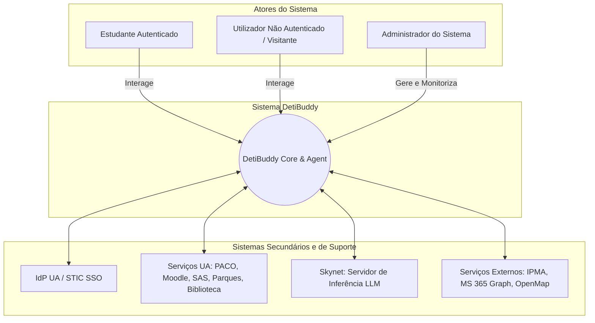
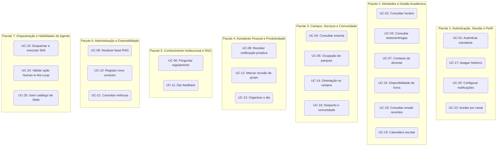

# DetiBuddy — Atores, User Stories e Use Cases

> **Fase de Elaboração — Projeto em Engenharia Informática (PEI 2026/2027)**  
> **Versão:** 2.0 (Fase de Elaboração — Outubro de 2026)  
> **Autores:** Arthur Haerdy, Francisco Amaro, Geovana Mayer, Lisle Faria, Samuel Ramos  
> **Orientador:** Prof. Mário Antunes  

---

## 1. Atores do Sistema

Os intervenientes no sistema dividem-se em **Atores do Sistema** — que iniciam interações diretas com o DetiBuddy para atingir objetivos — e **Sistemas Secundários e de Suporte** — plataformas e serviços externos com os quais o DetiBuddy comunica para recolher dados, inferir respostas ou executar tarefas.

### 1.1 Atores do Sistema

| Ator | Descrição e Perfil |
|---|---|
| **Estudante Autenticado** | Aluno matriculado num curso do DETI que acede ao sistema com as credenciais institucionais `@ua.pt`. Possui acesso a dados académicos confidenciais (horários, salas, avaliações no PACO/Moodle, emails) e pode solicitar ações personalizadas (reuniões, notificações de senhas). É exemplificado pelas personas *Eunice* (caloiro nacional), *Paulo* (finalista nacional) e *Liam* (estudante internacional/Erasmus). |
| **Utilizador Não Autenticado / Visitante** | Qualquer membro da comunidade universitária, candidato ou visitante que acede ao assistente sem efetuar login. Acede unicamente a dados e serviços públicos (ementas das cantinas, regulamentos públicos do DETI, localização geral de edifícios e serviços do campus). Previsto no requisito FR-03. |
| **Administrador do Sistema** | Elemento da equipa técnica ou docente do DETI responsável pela manutenção e ciclo de vida do assistente. Carrega e atualiza documentos normativos na base de conhecimento vetorial (RAG) com controlo de validade, regista e configura novos conectores de serviços e analisa métricas agregadas de desempenho, utilização e erros. É personificado pelo *Eng. Rui*. |

> **Nota sobre Docentes e Investigadores:** Docentes e investigadores da UA que utilizem o assistente acedem com as suas credenciais sob o perfil de utilizador institucional autenticado (usufruindo de consultas de horários, reuniões e serviços comuns do campus), não existindo no âmbito do MVP da Fase de Elaboração funcionalidades privativas de pautas ou gestão pedagógica exclusiva de docentes.

#### Perfil Detalhado do Administrador
* **Papel:** Gestão da infraestrutura lógica do agente, qualidade do conhecimento e observabilidade.
* **Competências:** Conhecimentos de gestão de APIs, indexação de documentos (chunking e embeddings) e diagnóstico de conectores.
* **Preocupações Principais:** Assegurar que os regulamentos indexados estão atualizados e não contêm versões revogadas; configurar alertas de expiração de documentos normativos; garantir que nenhum dado pessoal de estudantes é exposto nos logs; monitorizar a latência e estabilidade da ligação à Skynet.

### 1.2 Sistemas Secundários e de Suporte

| Ator / Sistema | Tipo | Papel e Interação | Alternativa / Contingência |
|---|---|---|---|
| **IdP UA / STIC** | Secundário (Autenticação) | Provedor de Identidade institucional da Universidade de Aveiro. Valida as credenciais do utilizador (SSO / OAuth2) e emite tokens de sessão seguros. | **Plano B:** IdP simulado via **Keycloak (OIDC)** em contentor Docker; tokens de sessão JWT efémeros e autenticação local de contingência |
| **Serviços Académicos e de Campus da UA** | Secundário (Plataformas UA) | Conjunto de plataformas institucionais que alimentam as respostas do assistente: **PACO** (horários), **e-learning / Moodle** (datas de testes e avisos), **SAS** (ementas e senhas de atendimento), **Sistema de Parques** (ocupação de lugares) e **Biblioteca / SBIDM** (catálogo de livros). | **Plano B:** Mocks de APIs prontos (PACO e e-learning) desenvolvidos pela equipa; **Plano C:** Web scraping / automação via Playwright; **Quickload:** Pré-carregamento e cache estática em memória para dados de ementas SAS e parques |
| **Servidor Skynet** | Secundário (Infraestrutura) | Servidor de cálculo local da UA que hospeda o modelo de linguagem de grande escala (LLM *on-premise*). Responsável pelo processamento de linguagem natural, raciocínio (*reasoning*) e orquestração de chamadas de ferramentas (*tool calling*), garantindo a soberania dos dados. | Modelos quantizados locais mais leves de contingência (execução local) |
| **Serviços Externos de Apoio** | Secundário (Sistemas Externos) | **IPMA** (Instituto Português do Mar e da Atmosfera — previsão meteorológica) e **Microsoft 365 / Graph API** (leitura de emails recentes e gestão de eventos no calendário do estudante). | Cache local com última previsão válida / Quickload |
| **OpenStreetMap (OpenMap)** | Secundário (Cartografia) | Serviço aberto de cartografia e dados geoespaciais para mapas do campus, cálculo de rotas pedonais e percursos passo a passo entre edifícios e departamentos da UA. | Quickload de mapas estáticos / dados cartográficos locais em cache |

---

## 2. Prioridades de Desenvolvimento (MoSCoW)

* **M — Must have (Crítico para MVP da Elaboração):** Requisitos essenciais sem os quais o sistema não entra em produção nem atinge os objetivos de negócio.
* **S — Should have (Importante):** Requisitos de grande valor funcional que devem ser incluídos assim que o núcleo MVP estiver estável.
* **C — Could have (Desejável):** Funcionalidades complementares, a incorporar caso haja folga temporal (ex.: bot de Discord e aplicação nativa Android).
* **W — Won't have (Fora de Âmbito agora):** Funcionalidades expressamente descartadas para esta fase do projeto (ex.: pagamentos de propinas e saldo do cartão SAS).

---

## 3. User Stories (Histórias de Utilizador)

Formato: *Como \<ator>, quero \<objetivo>, para \<benefício>.*  
Critérios de aceitação expressos em *Dado que / Quando / Então*.

### E1 — Privacidade e Autenticação

| ID | História | Prio |
| --- | --- | --- |
| US-01 | Como **estudante**, quero autenticar-me com a minha conta UA, para que o assistente aceda aos meus dados pessoais e académicos em meu nome. *(Método de autenticação sujeito à validação técnica dos STIC.)* | M |
| US-02 | Como **estudante**, quero ter a garantia de que as minhas conversas e dados pessoais não saem da infraestrutura da UA, para confiar plenamente no assistente. | M |
| US-03 | Como **estudante**, quero poder apagar o meu histórico de conversas a qualquer momento, para manter o controlo integral sobre os meus dados (conformidade RGPD). | S |

* **Critérios US-01:** Dado um estudante não autenticado, quando solicita uma informação privada (ex.: o seu horário ou emails), então o assistente solicita autenticação institucional e só procede após sucesso. Credenciais e palavras-passe nunca são registadas em texto legível ou logs.
* **Critérios US-02:** Verificável por auditoria de tráfego de rede: nenhum pedido direcionado para APIs públicas fora da UA contém mensagens, números de aluno ou nomes.
* **Critérios US-03:** Dado um histórico de mensagens existente, quando o estudante solicita a sua eliminação com confirmação, então o histórico é permanentemente purgado do armazenamento.

### E2 — Serviços da UA

| ID | História | Prio |
| --- | --- | --- |
| US-04 | Como **estudante**, quero perguntar pelo meu horário letivo, para saber rapidamente onde e quando tenho aulas sem ter de abrir o PACO. | M |
| US-05 | Como **estudante**, quero saber as datas de testes e entregas de uma disciplina, para me organizar atempadamente (PACO / e-learning). *Exceção documentada: testes cujas datas só constem em ficheiros PowerPoint.* | M |
| US-06 | Como **estudante**, quero consultar a ementa da cantina do dia, para decidir onde almoçar no campus (SAS). | M |
| US-07 | Como **estudante**, quero saber a ocupação dos parques de estacionamento, para escolher onde estacionar antes de chegar à universidade. | S |
| US-08 | Como **estudante**, quero consultar o estado da minha senha de atendimento presencial nos serviços, para gerir o meu tempo sem ficar na fila. | S |
| US-09 | Como **estudante**, quero consultar os meus emails recentes da UA, para não perder avisos pedagógicos urgentes. | C |

* **Critérios US-04:** Tempo de resposta inferior a 10 s; perante falha do PACO, o assistente devolve uma mensagem clara de indisponibilidade sem inventar horários.
* **Critérios US-05:** Dado o nome ou código de uma disciplina, o assistente apresenta as datas acompanhadas da fonte oficial e hora de consulta. Se as datas apenas existirem em apresentações PowerPoint não indexadas, o assistente informa explicitamente que não é possível obter o dado.

### E3 — Assistente Pessoal (Organização e Produtividade)

| ID | História | Prio |
| --- | --- | --- |
| US-10 | Como **estudante**, quero pedir ao assistente para marcar uma reunião de grupo de projeto, para que envie os convites por email e crie o evento no calendário. | S |
| US-11 | Como **estudante**, quero pedir ao assistente para organizar o meu dia, para receber um plano unificado de aulas, entregas e eventos relevantes. | S |
| US-12 | Como **estudante**, quero uma recomendação de indumentária baseada no tempo e no percurso para a universidade, para me preparar adequadamente. | C |

* **Critérios US-10:** O assistente identifica participantes, data e hora; apresenta um resumo detalhado e **só envia emails ou altera o calendário após confirmação explícita** do estudante.
* **Critérios US-11:** O assistente combina horário do PACO e compromissos do calendário; gera uma proposta estruturada e só faz marcações após validação.
* **Critérios US-12:** A recomendação consulta o serviço IPMA; em caso de indisponibilidade da meteorologia, avisa que o dado meteorológico não foi obtido.

### E4 — Orientação no Campus e Serviços de Apoio

| ID | História | Prio |
| --- | --- | --- |
| US-13 | Como **estudante**, quero perguntar pela localização dos balcões do PACO e receber direções passo a passo, para me orientar rapidamente. | S |
| US-14 | Como **estudante**, quero saber quais os procedimentos e documentos necessários para tratar de um processo académico (ex.: passe de autocarro, certidões), para resolver o assunto à primeira. | S |
| US-15 | Como **estudante**, quero saber se a biblioteca dispõe de livros recomendados para uma disciplina e se estão disponíveis para empréstimo. | S |
| US-16 | Como **estudante**, quero saber que serviços existem no campus (CTT, farmácia, CUA) e os respetivos horários de funcionamento. | S |

* **Critérios US-13 a US-16:** As respostas baseiam-se nos manuais e documentação indexada; se a informação for inexistente, o assistente recusa-se a inventar (*"Não disponho dessa informação"*) e fornece o contacto oficial do serviço.

### E5 — Vida Académica, Desporto e Comunidade

| ID | História | Prio |
| --- | --- | --- |
| US-17 | Como **estudante**, quero informações sobre atividades desportivas na UA (modalidades, horários, ginásio, tarifas e reserva da nave desportiva), para manter uma rotina ativa. | S |
| US-18 | Como **estudante**, quero saber quais os jogos da Taça UA a decorrer, para poder acompanhar a competição. | C |
| US-19 | Como **estudante**, quero obter guias e prazos sobre o programa Erasmus+, para me candidatar com sucesso. | C |
| US-20 | Como **estudante**, quero conhecer os núcleos do DETI (ex.: NEI, NETA) e a associação académica, para me integrar na comunidade. | S |
| US-21 | Como **estudante**, quero saber como participar em grupos de interesse técnico e extracurricular (GLUA, NERD, UAC, Nave). | C |

### E6 — Conhecimento Oficial do DETI e Regulamentos (RAG)

| ID | História | Prio |
| --- | --- | --- |
| US-22 | Como **estudante**, quero fazer perguntas sobre o regulamento pedagógico (faltas, épocas especiais, regime de avaliação), para esclarecer dúvidas com segurança. | M |
| US-23 | Como **estudante**, quero consultar os contactos institucionais e o número de gabinete de um docente, para falar com ele presencialmente ou por email. | M |
| US-24 | Como **estudante**, quero consultar as datas-chave do calendário escolar (feriados letivos, paragens e épocas de exames). | S |
| US-25 | Como **estudante**, quero que cada resposta sobre regulamentos inclua a citação explícita da fonte oficial (nome do documento e artigo/secção), para poder conferir a veracidade. | M |

* **Critérios US-22 e US-25:** Toda a resposta baseada em RAG cita expressamente o documento e secção de suporte. Na ausência de excertos com alta confiança, o assistente não alucina e indica o contacto da secretaria do DETI.

### E7 — Canais de Interação

| ID | História | Prio |
| --- | --- | --- |
| US-26 | Como **estudante**, quero interagir com o assistente através de uma interface web responsiva e instalável (**React PWA** para desktop e mobile), sem necessitar de recorrer a lojas de aplicações. | M |
| US-27 | Como **estudante**, quero poder aceder ao assistente via Discord num canal privado, para usar a plataforma onde já comunico com os colegas. | C |
| US-28 | Como **estudante**, quero opcionalmente uma aplicação Android nativa empacotada para usar no campus. *(Classificada como Could have, estando a mobilidade principal já assegurada pela React PWA).* | C |

### E8 — Notificações Proativas

| ID | História | Prio |
| --- | --- | --- |
| US-29 | Como **estudante**, quero receber uma notificação automática quando a minha senha de atendimento presencial estiver próxima de ser chamada. | S |
| US-30 | Como **estudante**, quero ser notificado quando existirem vagas disponíveis no meu parque de estacionamento habitual. | C |
| US-31 | Como **estudante**, quero poder gerir e cancelar a qualquer momento as minhas subscrições de notificações ativas. | S |

### E9 — Administração e Extensibilidade

| ID | História | Prio |
| --- | --- | --- |
| US-32 | Como **administrador**, quero carregar ou atualizar documentos em PDF da base de conhecimento com metadados de validade e alertas automáticos de expiração, para manter as respostas do assistente corretas e atuais. | M |
| US-33 | Como **administrador**, quero registar novos conectores de serviços através de uma interface padronizada, sem alterar o núcleo do sistema (*Modular Conector Architecture*). | M |
| US-34 | Como **administrador**, quero monitorizar painéis de utilização, tempos de resposta e ocorrências de erros por conector, para otimizar o sistema. | S |

### E10 — Avaliação Contínua da Solução

| ID | História | Prio |
| --- | --- | --- |
| US-35 | Como **estudante**, quero poder classificar cada resposta com 👍/👎 e submeter um comentário opcional, para ajudar a equipa a aperfeiçoar o assistente. | S |

### E11 — Habilidades e Inteligência do Agente (Skills & Roteamento)

| ID | História | Prio |
| --- | --- | --- |
| US-36 | Como **estudante**, quero que o assistente reconheça de forma inteligente o objetivo da minha questão e ative a habilidade (*skill*) especializada correta, para obter uma resposta precisa sem sobrecarga de processamento ou erros de interpretação. | M |
| US-37 | Como **estudante**, quero acompanhar o progresso das ações do assistente em tempo real e validar previamente ações sensíveis via cartões interativos (*Human-in-the-Loop*), para compreender o raciocínio do agente e interagir com segurança. | S |
| US-38 | Como **administrador**, quero consultar e gerir o catálogo de skills do agente com controlo de permissões e telemetria, para calibrar e estender as capacidades operacionais do DetiBuddy de forma modular. | M |

* **Critérios US-36:** O assistente classifica o pedido na respetiva Skill (ex.: `AcademicScheduleSkill`, `RegulatoryConsultationSkill`) e injeta no LLM apenas as ferramentas estritamente associadas a essa habilidade (*Just-in-Time Tool Injection*).
* **Critérios US-37:** A interface web apresenta indicadores visuais de progresso de execução e, perante ações com efeito externo (marcação de reuniões ou envio de emails), suspende o fluxo e renderiza um cartão estruturado com botões de aprovação/rejeição.
* **Critérios US-38:** A consola de administração disponibiliza o estado das skills registadas, ferramentas associadas, tempos médios de resposta e taxas de sucesso.

---

## 4. Use Cases (Casos de Uso) Organizados por Pacotes

Os 25 Casos de Uso do sistema encontram-se estruturados em **7 Pacotes Lógicos (*Packages*)**, de acordo com as boas práticas de Engenharia de Software e modelação ágil:

> **Artefactos Visuais de Modelação (UML):** A modelação visual de Casos de Uso segundo o padrão *Agile Modeling* encontra-se disponível na pasta `docs/diagrams/use_case/`: consulte o [Diagrama Geral com Casos de Uso](../diagrams/use_case/DetiBuddy_Use_Cases_Completo.png) e o [Diagrama Simplificado por Pacotes Funcionais](../diagrams/use_case/DetiBuddy_Use_Cases_Simplificado.png).  
> **Nota de Rastreabilidade:** A história **US-02** (*Privacidade e confinamento on-premise*) representa um requisito transversal de qualidade e governança. Encontra-se coberta diretamente pelos requisitos **NFR-01**, **NFR-02** e **FR-07**, não necessitando de um caso de uso operacional isolado.

### Índice Resumo de Casos de Uso por Pacotes

| Pacote | ID | Caso de Uso | Ator Principal | Histórias de Utilizador |
|---|---|---|---|---|
| **Pacote 1: Autenticação, Sessão e Perfil** | **UC-01** | Autenticar estudante | Estudante | US-01 |
| | **UC-17** | Apagar histórico de conversas | Estudante | US-03 |
| | **UC-20** | Configurar notificações | Estudante | US-31 |
| | **UC-22** | Aceder ao assistente por um canal | Estudante / Visitante | US-26, US-27, US-28 |
| **Pacote 2: Atividades e Gestão Académica** | **UC-02** | Consultar horário letivo | Estudante | US-04 |
| | **UC-03** | Consultar datas de testes e entregas | Estudante | US-05 |
| | **UC-07** | Consultar contacto e gabinete de docente | Estudante / Visitante | US-23 |
| | **UC-15** | Consultar disponibilidade de livros | Estudante | US-15 |
| | **UC-18** | Consultar emails recentes da UA | Estudante | US-09 |
| | **UC-19** | Consultar calendário escolar | Estudante / Visitante | US-24 |
| **Pacote 3: Campus, Serviços e Comunidade** | **UC-04** | Consultar ementa da cantina | Estudante / Visitante | US-06 |
| | **UC-05** | Consultar ocupação de parques | Estudante | US-07 |
| | **UC-14** | Orientar no campus e explicar procedimentos | Estudante / Visitante | US-13, US-14, US-16 |
| | **UC-16** | Consultar informação de desporto e comunidade | Estudante | US-17, US-18, US-19, US-20, US-21 |
| **Pacote 4: Assistente Pessoal e Produtividade** | **UC-08** | Receber notificação proativa | Estudante | US-08, US-29, US-30 |
| | **UC-12** | Marcar reunião de grupo de projeto | Estudante | US-10 |
| | **UC-13** | Organizar o dia | Estudante | US-11, US-12 |
| **Pacote 5: Conhecimento Institucional (RAG)** | **UC-06** | Perguntar sobre regulamento pedagógico | Estudante / Visitante | US-22, US-25 |
| | **UC-11** | Dar feedback sobre resposta | Estudante / Visitante | US-35 |
| **Pacote 6: Administração e Extensibilidade** | **UC-09** | Atualizar base de conhecimento | Administrador | US-32 |
| | **UC-10** | Registar novo conector de serviço | Administrador | US-33 |
| | **UC-21** | Consultar métricas de utilização e diagnóstico | Administrador | US-34 |
| **Pacote 7: Orquestração e Habilidades (Skills)** | **UC-23** | Despachar e executar Skill especializada | Estudante / Visitante | US-36, US-37 |
| | **UC-24** | Validar ação Human-in-the-Loop | Estudante | US-10, US-37 |
| | **UC-25** | Gerir catálogo e permissões de Skills | Administrador | US-33, US-38 |

---

### Pacote 1 — Autenticação, Sessão e Gestão de Perfil

#### UC-01 — Autenticar estudante
* **Ator Principal:** Estudante · **Atores Secundários:** IdP UA / STIC
* **Pré-condições:** O estudante possui conta institucional `@ua.pt` ativa.
* **Garantias de Sucesso (Pós-condições):** Sessão autenticada criada; token JWT seguro emitido; credenciais e palavras-passe nunca são registadas em texto limpo nem em ficheiros de log.
* **Fluxo Principal:**
  1. O estudante envia uma mensagem através do canal de chat solicitando dados pessoais ou académicos.
  2. O assistente deteta a necessidade de autenticação e devolve a ligação segura para login federado da UA.
  3. O estudante insere as suas credenciais no portal oficial da UA.
  4. O IdP valida o utilizador e devolve a confirmação com o token seguro ao backend do DetiBuddy.
  5. O assistente cria a sessão cifrada e retoma o atendimento ao pedido inicial do utilizador.
* **Fluxos Alternativos e Exceções:**
  * **3a. Credenciais Inválidas:** O portal institucional informa o erro; o sistema bloqueia tentativas repetitivas de acordo com a política de segurança da UA.
  * **4a. Serviço de Autenticação dos STIC Indisponível:** O assistente informa o utilizador sobre a falha temporária e mantém o funcionamento restrito apenas a questões públicas informativas (UC-04, UC-06).

#### UC-17 — Apagar histórico de conversas
* **Ator Principal:** Estudante · **Atores Secundários:** PostgreSQL / Repositório de Dados
* **Pré-condições:** O estudante tem sessão ativa.
* **Garantias de Sucesso (Pós-condições):** Todas as mensagens, dados de contexto de chat e metadados associados ao utilizador são permanentemente eliminados do armazenamento.
* **Fluxo Principal:**
  1. O estudante solicita verbalmente ou através da interface a eliminação do seu histórico (*"Apagar as minhas conversas"*).
  2. O assistente solicita confirmação explícita do utilizador, avisando que a ação é irreversível.
  3. O estudante confirma a ação.
  4. O sistema purga todas as instâncias de mensagens da base de dados e limpa a memória da sessão atual.
  5. O assistente confirma a eliminação com sucesso.
* **Fluxos Alternativos:**
  * **3a. Cancelamento:** O estudante recusa ou não confirma; o sistema mantém o histórico intacto.

#### UC-20 — Configurar notificações
* **Ator Principal:** Estudante
* **Pré-condições:** Sessão ativa.
* **Garantias de Sucesso:** Preferências de notificação persistidas na base de dados.
* **Fluxo Principal:**
  1. O estudante solicita ver ou alterar as suas notificações ativas.
  2. O assistente lista as subscrições configuradas (ex.: alerta de senha de atendimento, parque predefinido).
  3. O estudante especifica as alterações desejadas (ativar, suspender ou eliminar subscrição).
  4. O sistema atualiza o registo e devolve uma mensagem de confirmação.
* **Fluxos Alternativos:**
  * **2a. Sem subscrições ativas:** O assistente informa que não há alertas pendentes e sugere comandos para criar novas notificações.

#### UC-22 — Aceder ao assistente por um canal
* **Ator Principal:** Estudante / Visitante · **Atores Secundários:** Frontend Web, Discord
* **Pré-condições:** Conetividade de rede disponível.
* **Garantias de Sucesso:** Canal de conversação inicializado com sucesso.
* **Fluxo Principal:**
  1. O utilizador acede à aplicação web do DetiBuddy (React PWA) através do browser (ou Discord, caso disponível).
  2. A interface estabelece uma ligação segura (HTTPS e canal de streaming SSE) com o backend FastAPI através do proxy reverso Traefik.
  3. O assistente apresenta uma mensagem de boas-vindas e aguarda instruções.
* **Fluxos Alternativos:**
  * **1a. Indisponibilidade temporária de canal:** A interface apresenta mensagem amigável de reconexão e convida o utilizador a tentar instantes depois.

---

### Pacote 2 — Gestão e Atividades Académicas

#### UC-02 — Consultar horário letivo
* **Ator Principal:** Estudante · **Atores Secundários:** PACO, Skynet
* **Pré-condições:** Sessão autenticada ativa (UC-01).
* **Garantias de Sucesso:** Informação rigorosa de aulas, salas, docentes e horas apresentada ao estudante; dados do horário não são persistidos além da sessão.
* **Fluxo Principal:**
  1. O estudante pergunta: *"Que aulas tenho hoje à tarde?"*.
  2. O modelo de linguagem identifica a intenção e invoca o conector do PACO com os parâmetros temporais.
  3. O conector consulta o horário oficial do estudante.
  4. O assistente formata e devolve a listagem clara com nome da disciplina, tipo de aula (T/TP/PL), hora e sala.
* **Fluxos Alternativos:**
  * **3a. Conector PACO Indisponível / Sem Conexão:** O sistema devolve mensagem clara de falha técnica temporária sem inventar nem deduzir aulas.
  * **3b. Ausência de aulas na data solicitada:** O assistente informa cordialmente: *"Não tens aulas agendadas para essa data"*.

#### UC-03 — Consultar datas de testes e entregas
* **Ator Principal:** Estudante · **Atores Secundários:** e-learning / Moodle, PACO, Skynet
* **Pré-condições:** Sessão autenticada ativa; estudante devidamente inscrito na UC.
* **Garantias de Sucesso:** Prazos e datas apresentados com indicação da fonte oficial e timestamp de consulta.
* **Fluxo Principal:**
  1. O estudante pergunta: *"Quando é a primeira entrega de PEI?"*.
  2. O assistente resolve o nome informal para o identificador da UC e chama o conector pedagógico.
  3. O conector acede às avaliações registadas na página da disciplina no Moodle/PACO.
  4. O assistente extrai as datas, apresenta-as ao utilizador e adiciona a fonte oficial e hora de recolha.
* **Fluxos Alternativos:**
  * **2a. Disciplina Ambígua:** O assistente solicita clarificação (*"Referes-te a PEI de LEI ou PEI de MIEET?"*).
  * **3a. Datas Ausentes ou Apenas em Diapositivos PowerPoint:** O assistente informa explicitamente que a avaliação não está registada nos campos oficiais do e-learning e sugere consultar o docente (UC-07).
  * **3b. Aluno não inscrito:** O assistente indica a impossibilidade de aceder à página da UC por ausência de inscrição.

#### UC-07 — Consultar contacto e gabinete de docente
* **Ator Principal:** Estudante / Visitante · **Atores Secundários:** Base de Dados DETI / RAG
* **Pré-condições:** Nenhuma (informação de natureza pública).
* **Garantias de Sucesso:** Email institucional, sala/gabinete e horário de atendimento comunicados.
* **Fluxo Principal:**
  1. O utilizador questiona: *"Onde fica o gabinete do Professor Mário Antunes?"*.
  2. O assistente pesquisa na base de dados de docentes e diretório do DETI.
  3. O assistente apresenta o gabinete, o email oficial e o horário de atendimento aos alunos.
* **Fluxos Alternativos:**
  * **2a. Ambiguidade de nome:** O sistema apresenta a lista de docentes correspondentes para seleção do utilizador.
  * **2b. Docente não encontrado:** O assistente informa a inexistência de registo e faculta o contacto geral da secretaria do DETI.

#### UC-15 — Consultar disponibilidade de livros na biblioteca
* **Ator Principal:** Estudante · **Atores Secundários:** SBIDM / Biblioteca UA
* **Pré-condições:** Conexão ativa aos serviços da biblioteca.
* **Garantias de Sucesso:** Estado dos exemplares apresentado de forma precisa.
* **Fluxo Principal:**
  1. O estudante pesquisa por bibliografia de uma disciplina ou por um título específico de livro.
  2. O conector consulta o catálogo bibliográfico da UA.
  3. O assistente indica a cota, a biblioteca onde se encontra e se está atualmente disponível ou requisitado.
* **Fluxos Alternativos:**
  * **2a. Falha no catálogo:** Informa a indisponibilidade momentânea do serviço da biblioteca.

#### UC-18 — Consultar emails recentes da UA
* **Ator Principal:** Estudante · **Atores Secundários:** Microsoft 365 / Graph API
* **Pré-condições:** Sessão ativa com consentimento concedido para leitura de emails institucionais.
* **Garantias de Sucesso:** Resumo dos remetentes, assuntos e datas dos últimos emails em formato de leitura exclusiva.
* **Fluxo Principal:**
  1. O estudante pergunta: *"Tenho algum email novo de professores hoje?"*.
  2. O conector de email acede via Graph API à caixa de entrada (modo *read-only*).
  3. O assistente extrai e sintetiza os emails mais recentes, destacando remetente e assunto.
* **Fluxos Alternativos:**
  * **2a. Caixa de correio sem novas mensagens:** O assistente informa que não existem emails novos por ler.
  * **2b. Falha de autorização OAuth:** O assistente solicita renovação da autorização de acesso ao correio.

#### UC-19 — Consultar calendário escolar
* **Ator Principal:** Estudante / Visitante · **Atores Secundários:** Base de Conhecimento RAG
* **Pré-condições:** Nenhuma (dados públicos).
* **Garantias de Sucesso:** Datas oficiais de interrupções, feriados e períodos de avaliação comunicadas com rigor.
* **Fluxo Principal:**
  1. O utilizador questiona: *"Quando começam as férias de Natal e a época de exames?"*.
  2. O sistema faz a recuperação vetorial sobre o documento oficial do Calendário Escolar da UA 2026/2027.
  3. O assistente devolve os intervalos de datas exatos, citando o despacho reitoral de homologação.
* **Fluxos Alternativos:**
  * **2a. Informação contraditória ou revisão em curso:** O assistente indica a versão mais recente em vigor e assinala a data da última atualização.

---

### Pacote 3 — Campus, Serviços e Comunidade

#### UC-04 — Consultar ementa da cantina
* **Ator Principal:** Estudante / Visitante · **Atores Secundários:** SAS
* **Pré-condições:** Nenhuma (acesso público).
* **Garantias de Sucesso:** Ementa diária das cantinas do campus apresentada discriminada por pratos.
* **Fluxo Principal:**
  1. O utilizador pergunta: *"O que há hoje para o almoço na cantina do Crasto?"*.
  2. O assistente invoca o conector dos SAS para obter o menu da data atual.
  3. O assistente apresenta as opções (Carne, Peixe, Dieta, Vegetariano e Sobremesa).
* **Fluxos Alternativos:**
  * **2a. Ementa ainda não disponibilizada pelos SAS:** O assistente avisa que a ementa para a refeição selecionada ainda não se encontra publicada pelos serviços.

#### UC-05 — Consultar ocupação de parques de estacionamento
* **Ator Principal:** Estudante · **Atores Secundários:** Sistema de Gestão de Parques UA
* **Pré-condições:** Disponibilidade de dados de telemetria dos parques.
* **Garantias de Sucesso:** Número de lugares livres e indicação do parque mais vantajoso.
* **Fluxo Principal:**
  1. O estudante questiona: *"Há lugares no parque do DETI ou no parque central?"*.
  2. O conector consulta o estado em tempo real dos sensores de contagem de viaturas.
  3. O assistente informa a disponibilidade em cada parque e assinala o parque com maior número de vagas livres.
* **Fluxos Alternativos:**
  * **2a. Telemetria com atraso superior a 15 minutos:** O assistente apresenta os valores, mas avisa expressamente o utilizador quanto à data/hora da última leitura válida.

#### UC-14 — Orientar no campus e explicar procedimentos
* **Ator Principal:** Estudante / Visitante · **Atores Secundários:** Base de Conhecimento RAG, OpenMap
* **Pré-condições:** Manuais e mapas do campus indexados.
* **Garantias de Sucesso:** Instruções passo a passo sobre percursos e documentação exigida.
* **Fluxo Principal:**
  1. O utilizador pergunta: *"Onde trato do passe de autocarro e o que preciso de levar?"*.
  2. O assistente pesquisa a base documental e identifica o local competente (ex.: balcão dos serviços académicos / terminal de Aveiro) e documentos obrigatórios (declaração de matrícula do PACO).
  3. O assistente apresenta a lista de requisitos e instruções de acesso físico apoiadas pelo OpenMap.
* **Fluxos Alternativos:**
  * **2a. Procedimento não documentado:** O assistente admite não ter o procedimento nos seus registos e faculta o contacto dos serviços académicos.

#### UC-16 — Consultar informação de desporto e comunidade
* **Ator Principal:** Estudante · **Atores Secundários:** Base de Conhecimento RAG
* **Pré-condições:** Dados institucionais desportivos indexados.
* **Garantias de Sucesso:** Modalidades, preçários, horários e contactos de núcleos do DETI apresentados.
* **Fluxo Principal:**
  1. O estudante questiona sobre inscrições no ginásio da universidade, horários da pista de atletismo ou núcleos estudantis (NEI, GLUA).
  2. O assistente consulta a base RAG e apresenta os horários, preços para alunos e formas de contacto.

---

### Pacote 4 — Assistente Pessoal e Produtividade

#### UC-08 — Receber notificação proativa
* **Ator Principal:** Estudante · **Atores Secundários:** Conectores SAS / Parques, Canal Web/Push
* **Pré-condições:** Subscrição prévia de alerta ativa (UC-20).
* **Garantias de Sucesso:** Notificação atempada entregue ao utilizador quando o limiar de evento é atingido.
* **Fluxo Principal:**
  1. O serviço de tarefas em segundo plano (*background worker*) monitoriza ciclicamente a condição (ex.: faltam 3 senhas para a vez do estudante nos SAS).
  2. O sistema deteta o cumprimento do critério.
  3. O assistente despacha a mensagem de notificação prioritária para a interface web/dispositivo do estudante.
* **Fluxos Alternativos:**
  * **3a. Falha temporária no canal:** O sistema armazena a notificação em fila de espera para reenvio ou assinala como pendente.

#### UC-12 — Marcar reunião de grupo de projeto
* **Ator Principal:** Estudante · **Atores Secundários:** Microsoft 365 Graph, Skynet
* **Pré-condições:** Sessão autenticada ativa com permissão delegada de escrita no calendário e email.
* **Garantias de Sucesso:** Convites enviados por correio eletrónico e evento adicionado ao calendário institucional.
* **Fluxo Principal:**
  1. O estudante introduz o pedido: *"Marca uma reunião com o meu grupo de PEI na próxima terça às 14h sobre os casos de uso"*.
  2. O assistente analisa a mensagem, identifica colegas envolvidos e dados em falta.
  3. O assistente gera e apresenta um resumo da operação (Participantes, Assunto, Data e Hora) num **cartão interativo de ação** na interface web e exige confirmação explícita através de botões `[Confirmar]` e `[Cancelar]`.
  4. O estudante clica em Confirmar (ou submete confirmação explícita).
  5. O assistente envia os emails aos destinatários e cria o evento de calendário via Graph API.
* **Fluxos Alternativos:**
  * **2a. Faltam emails ou dados:** O assistente solicita os dados ausentes antes de avançar.
  * **4a. O estudante clica em Cancelar ou solicita alteração:** Nenhuma ação externa é despachada.
  * **5a. Falha no envio da API:** O assistente avisa claramente sobre a falha e indica que o evento não foi agendado.

#### UC-13 — Organizar o dia
* **Ator Principal:** Estudante · **Atores Secundários:** PACO, Calendário, IPMA, Skynet
* **Pré-condições:** Sessão autenticada.
* **Garantias de Sucesso:** Proposta de agenda diária integrada apresentada ao estudante.
* **Fluxo Principal:**
  1. O estudante solicita: *"Organiza o meu dia de amanhã"*.
  2. O assistente reúne aulas do PACO, eventos do calendário institucional e dados meteorológicos do IPMA.
  3. O LLM constrói uma proposta integrada com blocos de tempo para aulas, estudo, pausas de refeição e recomendações contextuais.
  4. O estudante valida os itens sugeridos.
  5. Os novos itens aceites são sincronizados no calendário.
* **Fluxos Alternativos:**
  * **2a. Falha no conector IPMA ou e-learning:** O assistente organiza o plano com base nos dados disponíveis, explicitando as fontes que não puderam ser consultadas.

---

### Pacote 5 — Conhecimento Institucional e Regulamentos (RAG)

#### UC-06 — Perguntar sobre regulamento pedagógico
* **Ator Principal:** Estudante / Visitante · **Atores Secundários:** Base Vetorial (PostgreSQL + pgvector — Busca Híbrida), Skynet
* **Pré-condições:** Documentos normativos oficiais do DETI previamente indexados e atualizados.
* **Garantias de Sucesso:** Resposta exata estritamente baseada em artigos regulamentares, acompanhada pela referência formal do artigo e documento.
* **Fluxo Principal:**
  1. O utilizador questiona: *"A quantas aulas laboratoriais posso faltar sem perder frequência?"*.
  2. O sistema gera os *embeddings* da pergunta e recupera os excertos mais relevantes da base vetorial.
  3. O LLM formula a resposta restringindo-se estritamente ao conteúdo recuperado.
  4. O assistente devolve a resposta final, incluindo a citação obrigatória (ex.: *Regulamento de Avaliação Discente da UA, Artigo 14.º, N.º 2*).
* **Fluxos Alternativos:**
  * **2a. Similaridade Semântica Insuficiente (Score abaixo do limiar):** O assistente recusa-se a especular, declarando: *"Esta matéria não se encontra descrita nos regulamentos indexados"* e faculta o contacto da Direção de Curso ou Secretaria.
  * **2b. Conflito entre Versões Documentais:** O assistente prioriza a versão mais recente e menciona a revogação da norma anterior.

#### UC-11 — Dar feedback sobre resposta
* **Ator Principal:** Estudante / Visitante · **Atores Secundários:** Base de Dados do Sistema
* **Pré-condições:** Resposta emitida previamente pelo assistente na sessão atual.
* **Garantias de Sucesso:** Registo anónimo de avaliação (👍 / 👎) e comentário técnico armazenado para auditoria e melhoria do modelo.
* **Fluxo Principal:**
  1. O utilizador seleciona o botão de feedback associado à mensagem do bot e, opcionalmente, redige uma justificação.
  2. O sistema associa a pontuação ao identificador da resposta e aos parâmetros de recuperação utilizados (sem associar dados de identificação pessoal do aluno).
  3. A interface apresenta uma confirmação discreta de agradecimento pelo contributo.

---

### Pacote 6 — Administração do Sistema e Auditoria

#### UC-09 — Atualizar base de conhecimento
* **Ator Principal:** Administrador · **Atores Secundários:** Módulo RAG, Base Vetorial
* **Pré-condições:** Administrador autenticado com privilégios de gestão.
* **Garantias de Sucesso:** Novo documento fatiado (*chunking*), transformado em vetores de características, indexado na base vetorial com metadados de validade temporal e alertas de expiração configurados.
* **Fluxo Principal:**
  1. O administrador acede à consola de gestão e submete um ficheiro documental (PDF / Markdown), definindo a data de validade/vigência temporal do documento ou despacho.
  2. O pipeline de ingestão valida a integridade do ficheiro, extrai o texto, remove formatações espúrias e segmenta o conteúdo em pedaços com sobreposição (*chunking*).
  3. O módulo gera os *embeddings* através do modelo local da Skynet e persiste-os na base vetorial juntamente com os metadados de vigência.
  4. O sistema agenda alertas automáticos para avisar os administradores quando a data de validade do documento estiver próxima de terminar ou expirada.
  5. O sistema executa automaticamente uma bateria de consultas de validação e confirma a conclusão ao administrador.
* **Fluxos Alternativos:**
  * **2a. Formato de ficheiro inválido ou ficheiro corrompido:** O sistema rejeita o ficheiro, emite mensagem de erro detalhada e mantém a base de dados inalterada.

#### UC-10 — Registar novo conector de serviço
* **Ator Principal:** Administrador / Desenvolvedor · **Atores Secundários:** Orquestrador de Agente
* **Pré-condições:** O novo conector implementa a interface padronizada de ferramentas do DetiBuddy (MCP / BaseTool).
* **Garantias de Sucesso:** Nova capacidade operacional registada no catálogo de ferramentas do agente sem necessidade de modificar ou recompilar o núcleo do sistema.
* **Fluxo Principal:**
  1. O administrador acede ao painel de conectores e introduz o manifesto do conector (nome, descrição semântica das capacidades, esquemas de entrada/saída JSON e permissões exigidas).
  2. O sistema valida a conformidade da interface e regista a ferramenta no orquestrador.
  3. O modelo de linguagem passa imediatamente a poder invocar o conector quando deteta intenções correspondentes.
* **Fluxos Alternativos:**
  * **2a. Esquema de parâmetros inválido:** O orquestrador assinala a não conformidade e impede a ativação do conector.

#### UC-21 — Consultar métricas de utilização e diagnóstico
* **Ator Principal:** Administrador · **Atores Secundários:** PostgreSQL / Dashboard de Métricas
* **Pré-condições:** Administrador autenticado com privilégios.
* **Garantias de Sucesso:** Relatórios agregados de desempenho e saúde do sistema apresentados.
* **Fluxo Principal:**
  1. O administrador abre a interface de observabilidade.
  2. O sistema processa os registos de auditoria e apresenta gráficos de: latência média por conector, taxa de acerto do RAG, distribuição de intenções, falhas de conectores e avaliações dos utilizadores.
  3. O administrador pode filtrar as métricas por período temporal ou serviço específico.
* **Fluxos Alternativos:**
  * **2a. Ausência de dados no intervalo:** O painel indica a inexistência de pedidos registados no período selecionado.

---

### Pacote 7 — Orquestração e Habilidades do Agente (Skills Framework)

#### UC-23 — Despachar e executar Skill especializada
* **Ator Principal:** Estudante / Visitante · **Atores Secundários:** Orquestrador do Agente (FastAPI), Skill Registry, Servidores MCP, Skynet LLM
* **Pré-condições:** Mensagem conversacional submetida pelo utilizador; pelo menos uma Skill ativa no catálogo correspondente à intenção.
* **Garantias de Sucesso:** O assistente identifica a intenção semântica, restringe o conjunto de ferramentas às declaradas na Skill selecionada (*Just-in-Time Tool Injection*), executa as chamadas MCP necessárias e formula a resposta final fundamentada.
* **Fluxo Principal:**
  1. O utilizador submete uma questão (ex.: *"Qual a sala da minha próxima aula prática?"*).
  2. O classificador semântico identifica a habilidade correspondente (`AcademicScheduleSkill`).
  3. O orquestrador injeta no prompt do LLM unicamente as ferramentas MCP do PACO e as diretivas da skill.
  4. O agente invoca a ferramenta MCP com os parâmetros extraídos do contexto de sessão (NMEC, data atual).
  5. A resposta estruturada é transmitida via stream SSE com citações e dados auditados.
* **Fluxos Alternativos:**
  * **2a. Pergunta ambígua ou parâmetros em falta:** O sistema ativa o fluxo de elicitação conversacional (UC-24) solicitando esclarecimentos.
  * **3a. Falha transitória do conector MCP:** A Skill aciona a política de degradação graciosa (*Skill Fallback*), devolvendo os dados em cache com aviso ou indicando contacto alternativo.

#### UC-24 — Validar ação Human-in-the-Loop
* **Ator Principal:** Estudante · **Atores Secundários:** Orquestrador do Agente, Interface React PWA, Microsoft 365 MCP
* **Pré-condições:** Estudante autenticado solicitou uma ação com efeitos secundários externos (ex.: marcação de reunião de grupo — UC-12).
* **Garantias de Sucesso:** A operação mutável só é concretizada após a aceitação explícita do utilizador através de um cartão interativo na interface web.
* **Fluxo Principal:**
  1. O estudante instrui o assistente a marcar uma reunião de grupo.
  2. A skill (`MeetingCoordinationSkill`) valida os dados necessários (participantes, horário, assunto) e cruza disponibilidades.
  3. O orquestrador emite um evento de estado SSE `waiting_confirmation`, suspendendo a execução no backend.
  4. A interface web renderiza um cartão estruturado de confirmação com resumo dos dados e botões `[Confirmar]` e `[Cancelar]`.
  5. O estudante clica em `[Confirmar]`.
  6. O backend recebe o evento de validação, despacha a escrita via MCP e emite a confirmação de sucesso.
* **Fluxos Alternativos:**
  * **5a. O estudante cancela a operação:** O sistema descarta os parâmetros transitórios e responde confirmando o cancelamento sem qualquer alteração externa.

#### UC-25 — Gerir catálogo e permissões de Skills
* **Ator Principal:** Administrador · **Atores Secundários:** Skill Registry, PostgreSQL
* **Pré-condições:** Administrador autenticado com perfil técnico.
* **Garantias de Sucesso:** Habilidades do agente ativadas, desativadas ou reconfiguradas em tempo de execução sem paragem de serviço.
* **Fluxo Principal:**
  1. O administrador acede ao painel de controlo de capacidades do agente.
  2. O sistema lista as Skills registadas, o respetivo estado operacional, ferramentas MCP associadas e requisitos de autorização.
  3. O administrador altera as configurações de uma skill (ex.: ativa/desativa, ajusta limiares de confiança ou restringe a utilizadores autenticados).
  4. As alterações entram imediatamente em vigor no *Skill Registry* em memória/Redis.

