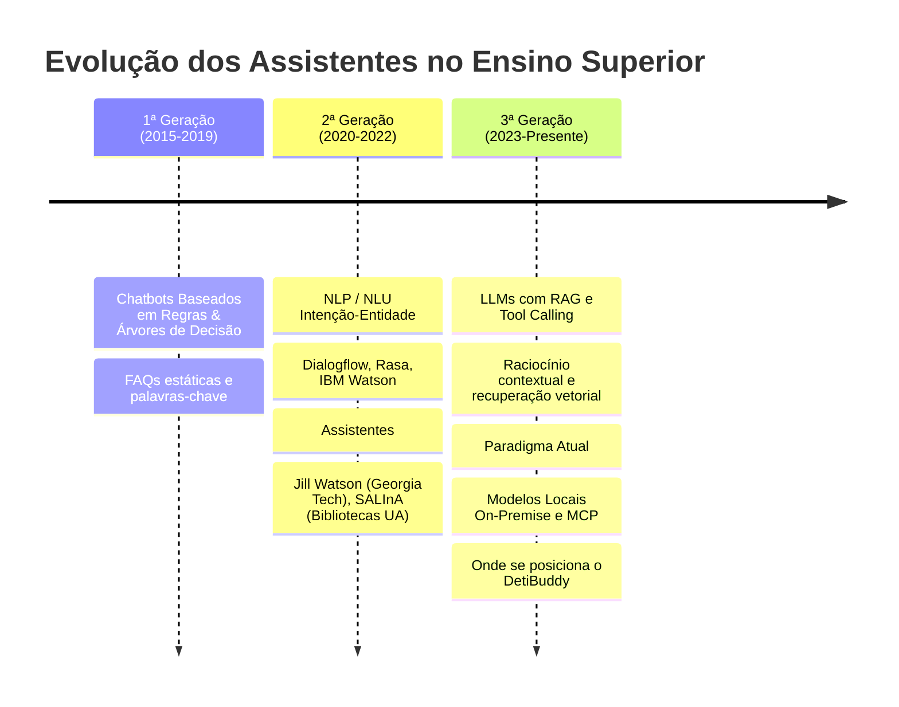
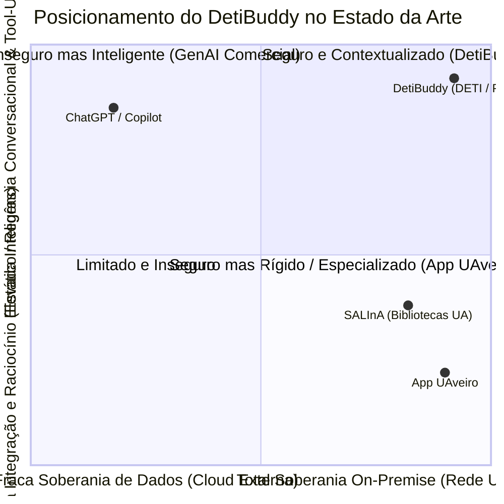

# DetiBuddy — Contexto e Estado da Arte (State of the Art - SOA)

> **Fase de Elaboração — Projeto em Engenharia Informática (PEI 2026/2027)**  
> **Autores:** Arthur Haerdy, Francisco Amaro, Geovana Mayer, Lisle Faria, Samuel Ramos  
> **Orientador:** Prof. Mário Antunes  

---

## 1. Contexto do Projeto e Cenário Operacional

O ambiente universitário contemporâneo caracteriza-se por um ecossistema digital heterogéneo e fragmentado. Na Universidade de Aveiro (UA), e em particular no Departamento de Eletrónica, Telecomunicações e Informática (DETI), a comunidade estudantil interage diariamente com uma multiplicidade de plataformas digitais independentes:
* **PACO (*Portal Académico da Comunidade Operacional*):** Gestão de matrículas, horários de aulas, turmas, pautas de avaliação e inscrições em exames.
* **e-learning (Moodle):** Conteúdos pedagógicos, fóruns de avisos de Unidades Curriculares (UCs), entregas de trabalhos de laboratório e datas de testes.
* **SAS (*Serviços de Ação Social*):** Gestão dos serviços de apoio e cantinas, incluindo ementas diárias, senhas de atendimento presencial e alojamento.
* **Sistemas de Gestão de Estacionamento:** Ocupação de parques no campus de Santiago.
* **Comunicação Institucional e Calendários:** Microsoft 365 (Webmail UA, Teams, Outlook Calendar) e repositórios documentais da Reitoria com os Regulamentos de Avaliação Discente.

### O Problema Central: Dispersão e Redundância no Acesso à Informação
Embora estes sistemas disponibilizem informação essencial, a experiência do utilizador é marcada por barreiras operacionais:
1. **Dispersão e Inconsistência:** O estudante necessita de abrir três a cinco aplicações distintas para planear um único dia académico (ex.: confirmar onde tem aula, ver se há ementa na cantina do Crasto e verificar a data limite de um relatório).
2. **Falta de Semântica e Linguagem Natural:** As plataformas exigem navegação manual hierárquica por menus densos e autenticação repetida.
3. **Privacidade e Proteção de Dados (RGPD):** O recurso a assistentes de inteligência artificial de consumo (como ChatGPT ou Copilot) para gerir tarefas académicas acarreta o risco severo de fuga de dados pessoais e académicos confidenciais para servidores em nuvens públicas de terceiros.

O **DetiBuddy** surge precisamente para responder a esta lacuna: atua como um assistente conversacional inteligente que unifica o acesso a estes sistemas e ao conhecimento regulamentar do DETI, executando toda a inferência de Inteligência Artificial e armazenamento **estritamente dentro da infraestrutura física da Universidade de Aveiro**.

---

## 2. Estado da Arte: Assistentes Inteligentes no Ensino Superior

A integração de agentes conversacionais no ensino superior tem evoluído através de três gerações tecnológicas distintas:

### 2.1 Da Primeira Geração aos Modelos de Linguagem de Grande Escala (LLMs)
* **Chatbots Clássicos Baseados em Regras:** Limitados a fluxogramas rígidos e deteção de palavras-chave. Falham perante formulações ambíguas, gíria estudantil ou perguntas fora do script pré-programado.
* **Assistentes de 2.ª Geração (ex.: Jill Watson - Georgia Tech; SALInA - Bibliotecas UA):** Introduziram classificação probabilística de intenções e entidades para responder a dúvidas em domínios específicos. No entanto, exigem configuração manual extensiva para cada nova intenção e não cruzam serviços dinâmicos externos.
* **Assistentes de 3.ª Geração (RAG e Agentes Autónomos):** O advento da arquitetura *Retrieval-Augmented Generation* (RAG) e da orquestração com ferramentas (*Tool Calling / Function Calling*) permite que um modelo de linguagem sintetize respostas a partir de regulamentos atualizados e consulte APIs dinâmicas em tempo real, sem necessidade de re-treino do modelo de base.

### 2.2 Desafios Emergentes na Literatura e Investigação Recente
Investigações recentes sobre a adoção de IA generativa em instituições de ensino superior (*e.g., ArXiv, IEEE, EDUCAUSE*) destacam quatro pontos críticos que norteiam o desenvolvimento do DetiBuddy:
1. **Soberania dos Dados e Conformidade Regulatória (RGPD / FERPA):** A transferência de dados institucionais (horários, números mecanográficos, notas e emails) para fornecedores externos de nuvem viola políticas de segurança universitárias. A tendência de ponta reside no *deployment* de modelos abertos e quantizados (*e.g., Llama 3, Mistral*) em clusters locais da própria universidade.
2. **Mitigação de Alucinações com Citação Estrita:** Em contexto de regras de faltas ou critérios de avaliação, uma resposta inventada gera prejuízo pedagógico imediato. O padrão moderno de RAG exige validação contextual, cálculo de confiança e **citação obrigatória de fontes oficiais** (documento e secção/artigo).
3. **Padrão de Orquestração Baseado em Ferramentas (*Tool-Use / MCP*):** O LLM não armazena dados voláteis nos seus pesos; funciona como um motor de raciocínio que despacha chamadas a serviços externos padronizados (ex.: *Model Context Protocol* ou FastAPI microservices).

---

## 3. Análise Comparativa de Soluções Existentes

Para posicionar o DetiBuddy, foram analisadas tanto as soluções institucionais em uso na Universidade de Aveiro como alternativas genéricas de mercado:

### 3.1 Soluções Existentes na Universidade de Aveiro
* **App UAveiro (Aplicação Móvel Oficial da UA):**
  * *Pontos Fortes:* Disponibiliza horários letivos básicos, ementas das cantinas, notícias institucionais e validação de senhas de cacifo.
  * *Limitações:* Interface estática baseada em navegação por janelas; não possui qualquer camada de inteligência conversacional; não responde a dúvidas sobre regulamentos; não integra com tarefas nem automatiza ações (como marcação de reuniões ou recomendações contextuais).
* **SALInA (Serviço de Apoio a Literacias e Informação Acessível - Bibliotecas UA):**
  * *Pontos Fortes:* Assistente virtual disponível no portal dos Serviços de Biblioteca, Informação Documental e Museologia (SBIDM); permite pesquisar no catálogo de livros e na base de dados Scopus; informa sobre a ocupação física das salas de leitura.
  * *Limitações:* Solução da 2.ª geração focada no domínio bibliotecário com base em intenções e FAQs; não dispõe de integração com o PACO, e-learning, parques de estacionamento ou gestão do quotidiano escolar do DETI, nem de capacidades generativas com RAG amplo ou invocação de ferramentas externas (*tool calling*).

### 3.2 Soluções Globais e Genéricas (ChatGPT, Microsoft Copilot, Claude)
* *Pontos Fortes:* Excelente fluência linguística em português, capacidade avançada de raciocínio e síntese.
* *Limitações Críticas:*
  * **Zero integração interna:** Não têm acesso autenticado às bases de dados privadas da UA (PACO, Moodle, SAS).
  * **Alucinações regulamentares:** Desconhecem as especificidades dos regulamentos internos do DETI, inventando datas ou regras genéricas.
  * **Violação de Privacidade:** O envio de mensagens privadas e dados académicos para servidores cloud de empresas terceiras viola as diretrizes do DETI e o RGPD.

---

## 4. Matriz Comparativa do Estado da Arte

| Dimensão / Funcionalidade | App UAveiro | SALInA (Bibliotecas UA) | Chatbots Comerciais (ChatGPT / Copilot) | DetiBuddy (PEI Elaboração) |
|---|:---:|:---:|:---:|:---:|
| **Interface Conversacional em Linguagem Natural** | ❌ Não | 🟡 Parcial (NLP / FAQ) |  Sim (avançado) |  **Sim (avançado via LLM)** |
| **Garantia de Privacidade On-Premise (Servidores UA)** |  Sim |  Sim | ❌ Não (Cloud externa) |  **Sim (Skynet + Servidor DETI)** |
| **Integração com Horários e Salas (PACO)** | 🟡 Parcial (estático) | ❌ Não | ❌ Não |  **Sim (tempo real)** |
| **Avaliações e Entregas (e-learning / Moodle)** | ❌ Não | ❌ Não | ❌ Não |  **Sim (tempo real)** |
| **Ementas e Serviços de Campus (SAS / Parques)** |  Sim (apenas ementa) | ❌ Não | ❌ Não |  **Sim (SAS + Vagas de Parques)** |
| **RAG com Citação de Regulamentos Oficiais** | ❌ Não | 🟡 Apenas regras de biblioteca | ❌ Alucina / Sem fontes |  **Sim (Documento + Artigo citado)** |
| **Automação de Tarefas (Reuniões, Calendário)** | ❌ Não | ❌ Não | 🟡 Requer integrações complexas |  **Sim (com confirmação explícita)** |
| **Notificações Proativas (Senhas, Vagas)** | ❌ Não | ❌ Não | ❌ Não |  **Sim (Subscrição de eventos)** |
| **Mecanismo Anti-Alucinação com Recusa Explícita** | N/A | 🟡 Resposta padrão de erro | ❌ Não |  **Sim (Fall-back para contacto oficial)** |

---

## 5. Diagrama Visual de Posicionamento Estratégico

O diagrama abaixo ilustra o posicionamento do **DetiBuddy** no espaço bidimensional de **Privacidade & Soberania dos Dados Institucionais** versus **Capacidade de Raciocínio & Integração com o Campus**:

### Análise dos Quadrantes:
1. **Quadrante 1 (Seguro e Contextualizado — DetiBuddy):** Combina inferência de Inteligência Artificial generativa avançada (orquestrada pela infraestrutura **Skynet**) com integração profunda em serviços académicos da UA e confinamento total dos dados à rede universitária.
2. **Quadrante 2 (GenAI Comercial):** Elevado raciocínio, mas inadequado para a academia devido à falta de acesso às bases de dados da UA e aos graves riscos de conformidade com o RGPD.
3. **Quadrante 4 (Seguro mas Rígido — App UAveiro e SALInA):** Soluções seguras e oficiais, mas confinadas a interfaces estáticas tradicionais ou a domínios muito restritos (bibliotecas), sem personalização holística para o quotidiano dos estudantes do DETI.

---

## 6. Proposta de Valor e Diferenciação na Fase de Elaboração

O DetiBuddy demarca-se de todo o trabalho prévio ao introduzir quatro pilares essenciais:
1. **Privacidade por Desenho (*Privacy by Design*):** A arquitetura baseia-se num servidor local FastAPI no DETI e no servidor de inferência **Skynet** da Universidade, assegurando que nenhum *prompt* ou histórico do estudante sai da rede da instituição.
2. **Orquestração Modular de Ferramentas (*Modular Tool Architecture*):** Capacidade de expandir as integrações (PACO, Moodle, SAS, Microsoft Graph) através de conectores plugáveis independentes, sem alterar o motor do agente.
3. **Fundamentação Rigorosa de Respostas (*Grounding & Trust*):** A base vetorial indexa regulamentos oficiais do DETI e calendários escolares; perante incerteza, o sistema recusa-se a inventar respostas e fornece o contacto oficial competente.
4. **Assistência Pró-ativa com Consentimento:** Ao contrário de portais reativos, o DetiBuddy permite que o estudante subscreva alertas inteligentes (ex.: ser avisado quando a senha de atendimento estiver próxima de ser chamada), exigindo sempre confirmação prévia para ações que alterem o calendário ou enviem emails.
