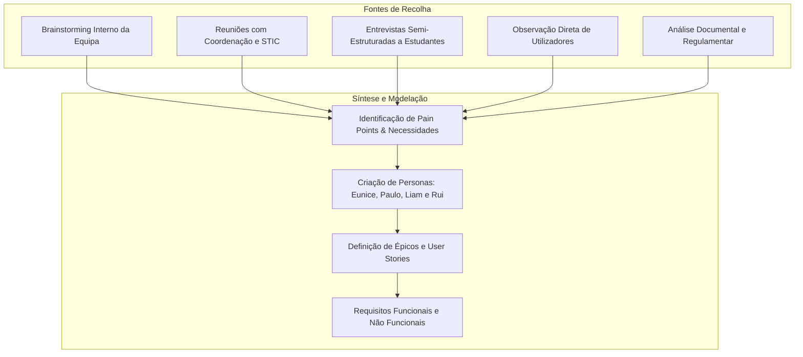

# DetiBuddy — Levantamento de Requisitos (Requirements Gathering)

> **Fase de Elaboração — Projeto em Engenharia Informática (PEI 2026/2027)**  
> **Autores:** Arthur Haerdy, Francisco Amaro, Geovana Mayer, Lisle Faria, Samuel Ramos  
> **Orientador:** Prof. Mário Antunes  

---

## 1. Introdução e Objetivos da Recolha

O levantamento de requisitos (*Requirements Gathering*) para o **DetiBuddy** teve como objetivo central compreender as dificuldades diárias dos estudantes do Departamento de Eletrónica, Telecomunicações e Informática (DETI) da Universidade de Aveiro (UA), mapear a fragmentação dos canais de informação e definir as necessidades funcionais e de privacidade essenciais para um assistente conversacional inteligente e contextualizado.

A recolha procurou responder a três questões fulcrais:
1. **Onde e quando sentem os estudantes maior fricção** no acesso a informação académica e serviços do campus?
2. **Que tarefas diárias justificam automação** ou agregação num ponto único de contacto?
3. **Quais são os limites de aceitação e privacidade** da comunidade académica face à partilha de credenciais e conversas com modelos de inteligência artificial?

---

## 2. Metodologia e Fontes de Informação

Para assegurar uma visão holística e representativa dos diferentes intervenientes (*stakeholders*), foram combinadas técnicas qualitativas e quantitativas de elicitação:

### 2.1 Brainstorming Interno da Equipa
* **Participantes:** Membros da equipa de desenvolvimento (Arthur Haerdy, Francisco Amaro, Geovana Mayer, Lisle Faria, Samuel Ramos).
* **Dinâmica:** Sessões de mapeamento de ideias e identificação de problemas comuns vivenciados no DETI (ex.: esquecimento de prazos de avaliação publicados apenas em ficheiros dispersos, incerteza sobre lugares de estacionamento e navegação pelos regulamentos de faltas e avaliação).
* **Resultado:** Mapeamento inicial dos 10 Épicos (E1 a E10).

### 2.2 Reuniões com Stakeholders Institucionais
* **Orientador de projeto (Prof. Mário Antunes):**
  * Alinhamento do âmbito técnico e arquitetural da solução.
  * Estabelecimento do compromisso inegociável de **soberania de dados**: o processamento de conversas e dados pessoais não pode ser delegado em modelos de cloud pública que quebrem as políticas da universidade ou o RGPD, devendo ser executado na infraestrutura local da UA (**Skynet** e servidores do DETI).
* **Contactos com os Serviços de Tecnologias da Informação e Comunicação (STIC):**
  * Levantamento das formas de integração e autenticação da UA (Single Sign-On / OAuth2 / IdP UA).
  * Análise das restrições de segurança associadas a APIs institucionais do PACO e e-learning, estruturando uma abordagem por níveis de contingência: incorporar o serviço diretamente se as APIs forem autorizadas pelos STIC (**Plano A**); utilizar mocks prontos das APIs do e-learning e PACO desenvolvidos pela equipa para desenvolvimento e testes contínuos (**Plano B**); e recorrer a automação via web scraping com Playwright apenas como **Plano C** (e não Plano B).

### 2.3 Entrevistas Semi-Estruturadas a Estudantes
Foram conduzidas entrevistas rápidas e direcionadas a estudantes do DETI com diferentes níveis de vivência académica:
* **Grupo A — Caloiros / 1.º Ano (representados pela Persona Eunice):**
  * *Padrão identificado:* Desorientação com a multiplicidade de plataformas (PACO, Moodle, SAS, Webmail); dificuldade em encontrar gabinetes de docentes; desconhecimento das regras de avaliação (ex.: épocas de exame, estatutos, limites de faltas); necessidade de saber onde almoçar e horários de serviços de apoio.
* **Grupo B — Estudantes dos restantes anos / não do 1.º ano (representados pela Persona Paulo):**
  * *Padrão identificado:* Conhecem as plataformas, mas estão saturados do tempo perdido em consultas repetitivas e manuais; necessitam de alertas rápidos de datas de entrega, estado de senhas de atendimento, vagas nos parques de estacionamento e sumarização de emails institucionais.

### 2.4 Observação e Testes com os Elementos da Equipa
* Testes práticos e observação do percurso habitual dos elementos da equipa para responder a perguntas frequentes do dia a dia:
  * *Exemplo 1:* Para saber se tem aula de laboratório e em que sala, o aluno precisa de abrir o browser, navegar até ao PACO, fazer login com credenciais/2FA, clicar no horário semanal e navegar até ao dia pretendido. Tempo médio observado: **45 a 90 segundos**.
  * *Exemplo 2:* Para saber a ementa do dia, o aluno abre o portal dos SAS ou app externa, navega pelo calendário e seleciona a cantina.
  * *Exemplo 3:* Para confirmar uma data de teste, o aluno tem de entrar no e-learning da UC respetiva, procurar no fórum de avisos ou no plano da disciplina, constatando frequentemente que a data estava apenas mencionada num diapositivo PowerPoint.
* *Conclusão:* A dispersão em 4 ou 5 plataformas distintas gera dispersão e perda de tempo desnecessária.

### 2.5 Análise Documental e Regulamentar
* Levantamento dos documentos normativos oficiais da Universidade de Aveiro e do DETI:
  * Regulamento de Avaliação Discente da Universidade de Aveiro.
  * Regulamento de Inscrição, Matrícula e Frequência.
  * Calendário Escolar Oficial da UA 2026/2027.
  * Guias de apoio e manuais dos utilizadores do PACO.
* *Conclusão:* O conhecimento oficial é denso, extenso e estático (PDFs), tornando-o o candidato perfeito para uma arquitetura baseada em **RAG (*Retrieval-Augmented Generation*)**.

---

## 3. Síntese dos Principais *Pain Points* e Necessidades

| Problema Identificado | Causa Raiz | Necessidade Correspondente |
|---|---|---|
| **Dispersão de informação** | Cada serviço pertence a uma entidade diferente (STIC, SAS, Reitoria, DETI). | Assistente centralizado que atua como *interface única* em linguagem natural. |
| **Prazos e testes esquecidos** | Datas comunicadas em canais variados (anúncios Moodle, slides, emails). | Consulta rápida de avaliações agregadas por UC e lembretes proativos. |
| **Perda de tempo e deslocações** | Falta de visibilidade em tempo real sobre ocupação de parques e senhas. | Alertas de proximidade de atendimento e ocupação de parques de estacionamento. |
| **Complexidade regulamentar** | Regulamentos extensos em PDF que os alunos evitam ler. | Mecanismo RAG com citação rigorosa do documento e secção (anti-alucinação). |
| **Barreira de privacidade** | Desconfiança no envio de conversas ou dados académicos para LLMs cloud (OpenAI, Google). | Garantia de execução estritamente *on-premise* na infraestrutura da UA. |

---

## 4. Matriz de Rastreabilidade (Fontes → Personas → Épicos)

A tabela seguinte ilustra como cada fonte de levantamento originou os artefactos formais da Fase de Elaboração:

| Fonte de Recolha | Persona Impactada | Épicos Resultantes | Histórias de Utilizador / Requisitos |
|---|---|---|---|
| **Entrevistas 1.º Ano (Caloiros)** | Eunice | **E2** (Serviços UA) **E4** (Orientação Campus) **E6** (Conhecimento DETI) | US-04, US-06, US-13, US-14, US-22 a US-25 FR-13, FR-16, FR-26 a FR-29, FR-35 a FR-40 |
| **Entrevistas a Estudantes dos restantes anos (não do 1.º ano)** | Paulo | **E2** (Serviços UA) **E3** (Assistente Pessoal) **E8** (Notificações Proativas) | US-05, US-07, US-08, US-10 a US-12, US-29 a US-31 FR-14, FR-17, FR-18, FR-20 a FR-25, FR-44 a FR-47 |
| **Entrevistas a Alunos Internacionais** | Liam | **E3** (Apoio Bilingue) **E5** (Erasmus / Integração) **E6** (Regulamentos em EN) | US-19, US-22, US-25 FR-09 (Suporte Inglês), FR-32, FR-35 a FR-38 |
| **Observação e Testes com os Elementos** | Eunice, Paulo e Liam | **E7** (Canais de Acesso) **E10** (Avaliação Contínua) | US-26 (Interface Web), US-35 (Feedback 👍/👎) FR-41, FR-52, NFR-04, NFR-10 |
| **Análise Documental e Regulamentar** | Administrador (Rui) / Alunos | **E6** (RAG e Regulamentos) **E9** (Administração e Extensibilidade) | US-22, US-25, US-32 a US-34 FR-35 a FR-38, FR-48 a FR-51, NFR-11, NFR-16 (Facilidade de Manutenção e Atualização) |

---

## 5. Decisões de Refinamento de Âmbito na Fase de Elaboração

Com base nos dados recolhidos e na avaliação técnica de viabilidade:
1. **Remoção de Pagamento de Propinas e Saldo do cartão SAS do MVP:**  
   Identificou-se que lidar com transações financeiras e dados bancários exigiria certificações de segurança adicionais e aprovação institucional complexa dos STIC/SAS, constituindo um risco desproporcionado para o cronograma do projeto. Foram marcados como fora de âmbito da Elaboração.
2. **Priorização da Interface Web (Desktop e Mobile) em detrimento de Discord:**  
   As entrevistas e testes indicaram que a barreira à entrada é mínima se o assistente estiver acessível via web browser responsivo (desktop e website mobile). A integração no Discord e a aplicação Android nativa foram classificadas como *Could have* (C).
3. **Mecanismo Anti-Alucinação Mandatório:**  
   Os estudantes manifestaram que uma resposta errada sobre faltas ou datas de exame seria gravíssima. Por conseguinte, foi definido que o sistema deve responder expressamente *"Não encontrei informação nos documentos oficiais"* e indicar o contacto do serviço ou docente caso o contexto recuperado não contenha a resposta com elevado grau de confiança.
