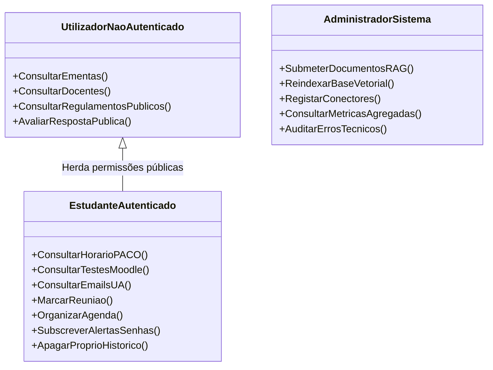

# DetiBuddy — Requisitos Funcionais e Não Funcionais

> **Fase de Elaboração — Projeto em Engenharia Informática (PEI 2026/2027)**  
> **Versão:** 2.0 (Fase de Elaboração — Outubro de 2026)  
> **Autores:** Arthur Haerdy, Francisco Amaro, Geovana Mayer, Lisle Faria, Samuel Ramos  
> **Orientador:** Prof. Mário Antunes  

---

## 1. Como Ler Este Documento

Este documento especifica formalmente as capacidades comportamentais (**Requisitos Funcionais — FR**), as regras organizacionais (**Regras de Negócio — RN**), a matriz de controlo de acessos (**RBAC**), as propriedades de qualidade e restrições técnicas (**Requisitos Não Funcionais — NFR**), e o enquadramento de **Pressupostos, Dependências e Restrições** do sistema DetiBuddy.

A rastreabilidade com as *User Stories* do documento homólogo é garantida pela coluna **US**.  
A priorização segue a metodologia **MoSCoW**:
* **M (Must have):** Requisito inegociável para o MVP funcional da Fase de Elaboração.
* **S (Should have):** Requisito de elevado valor a integrar assim que o núcleo estiver estabilizado.
* **C (Could have):** Requisito desejável mas não impeditivo da operação básica.
* **W (Won't have):** Funcionalidade fora do âmbito do ciclo de desenvolvimento atual.

---

## 2. Requisitos Funcionais (FR)

### 2.1 Autenticação e Gestão de Sessão

| ID | Requisito | US | Prio |
| --- | --- | --- | --- |
| FR-01 | O sistema deve autenticar o estudante com a conta institucional UA (`@ua.pt`) através do serviço IdP/SSO da UA. *(Método sujeito à aprovação e integração com os STIC).* | US-01 | M |
| FR-02 | O sistema deve criar e manter uma sessão cifrada associada ao estudante autenticado, expirando-a automaticamente após 30 minutos de inatividade. | US-01 | M |
| FR-03 | O sistema só deve exigir autenticação quando o pedido envolver dados de caráter pessoal ou académico privado; perguntas de cariz público devem ser respondidas sem login prévio. | US-01 | M |
| FR-04 | O sistema deve implementar controlo de taxa (*rate limiting*) e limitar o número de tentativas consecutivas de autenticação falhadas para mitigar ataques de força bruta. | US-01 | M |
| FR-05 | Em caso de indisponibilidade transitória do serviço de autenticação da UA, o sistema deve informar o utilizador e disponibilizar apenas as funcionalidades de domínio público. | US-01 | M |

### 2.2 Privacidade e Gestão de Dados Pessoais

| ID | Requisito | US | Prio |
| --- | --- | --- | --- |
| FR-06 | O sistema deve permitir ao estudante solicitar a eliminação imediata e definitiva do seu histórico de conversas, exigindo confirmação explícita prévia. | US-03 | S |
| FR-07 | O sistema não deve transmitir conteúdo de mensagens ou identificadores de estudantes a serviços externos fora da rede da UA; as invocações a APIs de terceiros (IPMA, mapas) devem conter apenas parâmetros anónimos estritamente necessários (ex.: coordenadas/cidade). | US-02 | M |

### 2.3 Assistente Conversacional e Orquestração de Agente

| ID | Requisito | US | Prio |
| --- | --- | --- | --- |
| FR-08 | O sistema deve classificar semanticamente a intenção do utilizador e despachar a execução para o conector de serviço ou pipeline RAG apropriado (*Tool Calling*). | todas | M |
| FR-09 | O sistema deve processar linguagem natural e responder fluentemente em Português de Portugal e, opcionalmente, em Inglês. | todas | S |
| FR-10 | Perante a falha de um serviço ou conector, o sistema deve assumir a incapacidade de obter a resposta e nunca inventar dados (*Mecanismo Anti-Alucinação*). | US-04, US-05 | M |
| FR-11 | As respostas factuais obtidas através de conectores devem indicar a fonte oficial consultada e o *timestamp* da leitura. | US-05, US-15 | M |
| FR-12 | Quando uma questão for semanticamente ambígua (ex.: siglas de unidades curriculares partilhadas ou docentes homónimos), o sistema deve solicitar clarificação ao utilizador. | US-05, US-23 | S |

### 2.4 Serviços Académicos e de Campus da UA

| ID | Requisito | US | Prio |
| --- | --- | --- | --- |
| FR-13 | O sistema deve devolver o horário letivo do estudante (disciplinas, salas, horários e tipologias de aula) para a data solicitada, obtido através da integração com o PACO. | US-04 | M |
| FR-14 | O sistema deve devolver as datas de testes e entregas de uma dada unidade curricular, resolvendo o nome informal para o identificador do plano de estudos. | US-05 | M |
| FR-15 | Caso as datas de avaliação de uma UC constem unicamente no interior de apresentações PowerPoint não estruturadas, o sistema deve informar que não é possível obter o dado automaticamente. | US-05 | M |
| FR-16 | O sistema deve fornecer a ementa diária das cantinas do campus (SAS) sem exigir autenticação do utilizador. | US-06 | M |
| FR-17 | O sistema deve indicar a lotação dos parques de estacionamento e sugerir o parque com maior disponibilidade, assinalando se os dados de telemetria tiverem mais de 15 minutos. | US-07 | S |
| FR-18 | O sistema deve consultar e devolver o estado atual da senha de atendimento presencial nos serviços académicos ou SAS. | US-08 | S |
| FR-19 | O sistema deve permitir a consulta em modo de leitura (*read-only*) dos cabeçalhos e resumos dos emails recentes da conta UA do estudante. | US-09 | C |

### 2.5 Assistente Pessoal e Produtividade

| ID | Requisito | US | Prio |
| --- | --- | --- | --- |
| FR-20 | O sistema deve extrair os dados necessários (participantes, data, hora, assunto) para agendar uma reunião de grupo quando solicitado pelo utilizador. | US-10 | S |
| FR-21 | Antes de expedir emails de convocatória ou registar eventos no calendário, o sistema deve apresentar um resumo formal da ação e exigir validação explícita do estudante. | US-10, US-11 | S |
| FR-22 | Após a confirmação do estudante, o sistema deve despachar os emails aos participantes e adicionar o evento ao calendário institucional (Microsoft 365 / Graph). | US-10 | S |
| FR-23 | O sistema deve organizar a agenda diária combinando os horários do PACO, reuniões do calendário e avisos recebidos por correio eletrónico. | US-11 | S |
| FR-24 | O sistema deve sincronizar no calendário institucional os blocos de estudo ou compromissos que o estudante aceitar na proposta de organização do dia. | US-11 | S |
| FR-25 | O sistema deve gerar uma recomendação contextual de indumentária cruzando a previsão meteorológica do IPMA com o percurso pedestre/rodoviário até ao campus. | US-12 | C |

### 2.6 Orientação no Campus e Serviços

| ID | Requisito | US | Prio |
| --- | --- | --- | --- |
| FR-26 | O sistema deve indicar a localização dos balcões do PACO e apresentar um guia passo a passo para o percurso com base no manual institucional. | US-13 | S |
| FR-27 | O sistema deve descrever os requisitos documentais e procedimentos para a tramitação de processos académicos (ex.: passe de transporte público, certidões). | US-14 | S |
| FR-28 | O sistema deve pesquisar no catálogo das bibliotecas da UA a disponibilidade de exemplares físicos para requisição recomendados para uma disciplina. | US-15 | S |
| FR-29 | O sistema deve informar sobre a localização e horários de funcionamento de serviços de apoio no campus (postos de CTT, farmácia, gabinetes da CUA). | US-16 | S |

### 2.7 Vida Académica, Desporto e Comunidade

| ID | Requisito | US | Prio |
| --- | --- | --- | --- |
| FR-30 | O sistema deve prestar esclarecimentos sobre a oferta desportiva da UA: modalidades disponíveis, preçários de ginásio e regras de reserva dos pavilhões desportivos. | US-17 | S |
| FR-31 | O sistema deve listar os jogos da Taça UA a decorrer na data e os respetivos resultados atualizados. | US-18 | C |
| FR-32 | O sistema deve disponibilizar guias informativos, prazos de candidatura e critérios de elegibilidade para o programa Erasmus+. | US-19 | C |
| FR-33 | O sistema deve fornecer contactos e informações institucionais dos núcleos de estudantes do departamento (NEI, NETA) e da Associação Académica (AAUAv). | US-20 | S |
| FR-34 | O sistema deve informar como ingressar em grupos técnicos extracurriculares sediados no DETI (GLUA, NERD, UAC, Nave). | US-21 | C |

### 2.8 Conhecimento Oficial do DETI e Regulamentos (RAG)

| ID | Requisito | US | Prio |
| --- | --- | --- | --- |
| FR-35 | O sistema deve formular respostas sobre o regulamento pedagógico e de avaliação com base estrita nos excertos indexados na base de conhecimento. | US-22 | M |
| FR-36 | As respostas fundamentadas em documentos normativos devem citar explicitamente o documento, número do artigo e alínea correspondente. | US-25 | M |
| FR-37 | Na ausência de excertos com grau de similaridade semântica suficiente para responder com certeza, o sistema deve admitir desconhecimento e indicar o contacto oficial competente. | US-22, US-25 | M |
| FR-38 | Perante revisões regulamentares concorrentes, o sistema deve dar precedência à versão mais recente e assinalar que se trata de uma versão atualizada. | US-22 | S |
| FR-39 | O sistema deve devolver o endereço eletrónico, localização do gabinete físico e horários de atendimento institucional de docentes do departamento. | US-23 | M |
| FR-40 | O sistema deve responder a questões relativas ao calendário escolar oficial (paragens letivas, períodos de avaliação e feriados). | US-24 | S |

### 2.9 Canais de Acesso

| ID | Requisito | US | Prio |
| --- | --- | --- | --- |
| FR-41 | O sistema deve disponibilizar uma interface gráfica web moderna e responsiva (desktop e mobile) em navegador, sem necessidade de instalação de software cliente. | US-26 | M |
| FR-42 | O sistema deve disponibilizar um bot conversacional na plataforma Discord com suporte a mensagens diretas privadas. | US-27 | C |
| FR-43 | O sistema deve disponibilizar uma aplicação cliente móvel nativa para sistema operativo Android. *(Classificada como Could have).* | US-28 | C |

### 2.10 Notificações Proativas

| ID | Requisito | US | Prio |
| --- | --- | --- | --- |
| FR-44 | O sistema deve permitir aos estudantes subscrever alertas de atendimento e despachar notificações quando a sua senha estiver próxima de ser atendida. | US-29 | S |
| FR-45 | O sistema deve permitir configurar um parque de estacionamento predefinido e notificar o utilizador da existência de vagas no início do período letivo. | US-30 | C |
| FR-46 | O estudante deve poder consultar, suspender ou eliminar qualquer subscrição de alertas ativa em qualquer momento. | US-31 | S |
| FR-47 | Em caso de falha transitória na entrega de notificações pelo canal ativo, o sistema deve tentar reenvio com retrocesso exponencial (*exponential backoff*). | US-29 | S |

### 2.11 Administração e Extensibilidade

| ID | Requisito | US | Prio |
| --- | --- | --- | --- |
| FR-48 | O sistema deve disponibilizar uma interface administrativa para submissão de novos documentos normativos em PDF com registo de data de validade/vigência temporal, executando automaticamente extração, segmentação (*chunking*), geração de *embeddings* e configurando alertas automáticos de expiração documental. | US-32 | M |
| FR-49 | Perante ficheiros corrompidos ou em formatos não autorizados, o sistema deve rejeitar o carregamento com código de erro descritivo, preservando o estado íntegro da base vetorial. | US-32 | M |
| FR-50 | O sistema deve suportar o registo dinâmico de novos conectores de dados via manifesto sem necessidade de modificação do código central do agente (*Plugin/Modular Architecture*). | US-33 | M |
| FR-51 | O sistema deve disponibilizar um painel de controlo de métricas para os administradores com relatórios de volume de pedidos, taxas de erro e tempos de resposta. | US-34 | S |

### 2.12 Avaliação e Melhoria Contínua

| ID | Requisito | US | Prio |
| --- | --- | --- | --- |
| FR-52 | O sistema deve disponibilizar botões de feedback rápido (👍 / 👎) e caixa de comentário em cada resposta, registando a classificação de forma totalmente dissociada da identidade do aluno. | US-35 | S |

---

## 3. Regras de Negócio (RN)

As Regras de Negócio definem as políticas institucionais e restrições lógicas inegociáveis que orientam o comportamento do DetiBuddy:

| ID | Nome da Regra | Descrição e Aplicação |
|---|---|---|
| **RN-01** | **Veracidade e Grounding (Tolerância Zero a Alucinações)** | O assistente está expressamente proibido de conjeturar ou inventar regras académicas ou datas de avaliação. Se a confiança estatística da recuperação for inferior a 0.70, o sistema deve emitir a mensagem padrão de desconhecimento e reencaminhar o utilizador para o canal humano competente. Este limiar de 0.70 aplica-se estritamente à ferramenta de RAG de normativos e regulamentos após classificação de intenção; mensagens sociais/saudações e ferramentas dinâmicas de campus (refeições SAS, estacionamento, meteorologia) são encaminhadas pelo orquestrador e processadas nos seus respetivos fluxos sem serem bloqueadas por este limiar. |
| **RN-02** | **Confirmação Prévia para Ações de Efeito Externo** | Nenhuma ação que resulte em escrita ou transmissão de dados para o exterior (ex.: envio de email de convocatória, criação de evento em calendário público ou partilhado) pode ser despachada sem validação explícita. O backend emite um evento estruturado de proposta de ação, renderizando na interface web um cartão interativo com botões [Confirmar] e [Cancelar] e resumo dos dados (remetente, destinatários, data, hora e conteúdo), eliminando ambiguidades de confirmação textual livre. |
| **RN-03** | **Minimização de Dados em Serviços Externos** | Quaisquer chamadas dirigidas a serviços de terceiros fora da infraestrutura da UA (ex.: IPMA) são estritamente anónimas. É expressamente interdito enviar nestes pedidos nomes de alunos, emails, identificadores de sessão ou excertos de conversa. |
| **RN-04** | **Soberania Territorial e Tecnológica dos Dados** | O modelo de linguagem de grande escala (LLM) e os repositórios de dados (PostgreSQL com extensão pgvector) devem residir fisicamente na infraestrutura do DETI e servidores Skynet da UA. É proibido o envio de dados de conversação para APIs de inferência em nuvens públicas comerciais. |
| **RN-05** | **Citação Obrigatória de Fontes Documentais e Vigência Temporal** | Qualquer resposta com base em RAG deve apresentar a identificação do documento oficial (ex.: *Regulamento de Avaliação Discente da UA*), a respetiva secção/artigo no original e a verificação da vigência temporal (metadados `data_inicio_vigencia` e `data_fim_vigencia`). Caso a data de validade tenha expirado, a resposta é obrigatoriamente apresentada com um aviso em destaque: *"⚠️ Aviso de Vigência: Este regulamento cessou a sua vigência em [data]. Confirme a existência de adenda atualizada junto dos serviços."* |
| **RN-06** | **Acesso Livre a Informação Pública** | Consultas relativas a ementas diárias, contactos e gabinetes de docentes, localização de edifícios e regulamentos gerais não requerem qualquer autenticação do utilizador, devendo ser servidas imediatamente a qualquer visitante. |
| **RN-07** | **Isolamento de Turmas e Inscrições** | O assistente só tem permissão para aceder e divulgar dados de horários e trabalhos laboratoriais relativos a Unidades Curriculares nas quais o aluno se encontre com inscrição regular e ativa no PACO. |
| **RN-08** | **Janela de Validade de Telemetria** | Informações sobre a disponibilidade de vagas de parques e senhas de atendimento só podem ser apresentadas se a última leitura válida de telemetria tiver ocorrido há menos de 15 minutos; caso contrário, devem ser acompanhadas de um aviso proeminente de potencial desatualização. |
| **RN-09** | **Anonimização Integral do Feedback de Utilizadores** | O registo de classificações de respostas (👍/👎) e comentários de avaliação não pode incluir chaves estrangeiras que liguem o feedback à identidade do estudante, salvaguardando a liberdade de avaliação do utilizador. |
| **RN-10** | **Direito ao Esquecimento Imediato (*Right to be Forgotten*)** | A receção de um pedido de eliminação de histórico de conversas (FR-06) despoleta a destruição atómica e irreversível de todas as mensagens de chat e representações vetoriais associadas ao identificador do estudante na base de dados. |

---

## 4. Matriz de Autenticação e Autorização (RBAC)

O DetiBuddy adota um modelo de Controlo de Acessos Baseado em Perfis (*Role-Based Access Control* — RBAC) com três perfis bem delimitados:

> **Nota de Enquadramento de Perfis:** Docentes e investigadores da UA acedem sob as permissões da classe `EstudanteAutenticado` (interpretada como utilizador institucional autenticado da comunidade UA para efeitos de consulta pessoal de horários, eventos de calendário e emails), estando reservadas para fases pós-MVP eventuais permissões de escrita ou gestão pedagógica exclusiva de docentes.

### Matriz de Permissões Operacionais

| Recurso / Operação | Visitante / Não Autenticado | Estudante Autenticado (@ua.pt) | Administrador do Sistema |
|---|:---:|:---:|:---:|
| **Consultar Ementas e Horários de Serviços** |  Permitido |  Permitido |  Permitido |
| **Consultar Regulamentos Gerais (RAG)** |  Permitido |  Permitido |  Permitido |
| **Consultar Horário Pessoal (PACO)** | ❌ Requer Login |  Permitido | ❌ Proibido (privacidade) |
| **Consultar Avaliações e Entregas (Moodle)** | ❌ Requer Login |  Permitido | ❌ Proibido (privacidade) |
| **Consultar Emails Institucionais (Graph)** | ❌ Requer Login |  Permitido | ❌ Proibido (privacidade) |
| **Agendar Reuniões e Modificar Calendário** | ❌ Requer Login |  Permitido | ❌ Proibido (privacidade) |
| **Subscrever Alertas de Senha de Atendimento** | ❌ Requer Login |  Permitido | ❌ Proibido (privacidade) |
| **Apagar Histórico Pessoal de Conversas** | ❌ Não aplicável |  Permitido (apenas o seu) | ❌ Não (apenas purga global) |
| **Submeter / Atualizar Documentos RAG** | ❌ Proibido | ❌ Proibido |  Permitido |
| **Registar / Configurar Conectores de APIs** | ❌ Proibido | ❌ Proibido |  Permitido |
| **Visualizar Painel de Métricas e Diagnóstico** | ❌ Proibido | ❌ Proibido |  Permitido |

---

## 5. Auditoria, Observabilidade e Retenção de Dados (RGPD)

### 5.1 Registo de Auditoria (*Logging*) Sem Dados Pessoais
Para cumprir as diretrizes europeias do RGPD e o requisito NFR-07:
* Os ficheiros de log do backend FastAPI registam apenas: *timestamp*, identificador interno de correlação de pedido (*request-id*), conector invocado, código de estado HTTP e tempo de execução em milissegundos.
* **Dados Estritamente Interditos nos Logs:** Palavras-passe, *tokens* JWT de autenticação, conteúdos de mensagens redigidas por utilizadores, identificadores de números de estudante e endereços de correio eletrónico.

### 5.2 Painel de Relatórios (*Reporting*)
O painel de administração disponibiliza métricas analíticas em conformidade com o FR-51:
* **Taxa de Disponibilidade por Conector:** Percentagem de sucesso nas invocações a PACO, Moodle, SAS e Skynet.
* **Latência Média de Inferência:** Tempo médio decorrido entre a submissão da pergunta e a receção do primeiro token (*TTFT*) emitido pelo LLM na Skynet.
* **Índice de Confiança RAG:** Frequência com que o motor vetorial devolve resultados acima do limiar de relevância vs. ativação do fallback de recusa.
* **Taxa de Satisfação Agregada:** Rácio global de avaliações positivas (👍) e negativas (👎) recebidas.

### 5.3 Política de Retenção e Ciclo de Vida dos Dados
* **Sessões Voláteis:** As sessões expiram ao fim de 30 minutos de inatividade, sendo os dados em memória efémera invalidados de imediato.
* **Histórico de Conversas:** As mensagens armazenadas em base de dados são mantidas apenas durante o semestre letivo em curso, sendo programada uma rotina automática de expurgo semestral para salvaguarda da privacidade.
* **Eliminação Imediata:** A invocação do UC-17 desencadeia uma operação de eliminação física (*hard delete*) sem cópias de segurança permanentes dos identificadores associados.

---

## 6. Requisitos Não Funcionais (NFR)

Os requisitos não funcionais especificam os critérios de qualidade e as restrições arquiteturais quantificadas do sistema:

| ID | Categoria | Especificação e Métrica Quantificável | Prio |
| --- | --- | --- | --- |
| **NFR-01** | **Privacidade e Soberania** | Todo o processamento de linguagem natural e inferência de modelos de IA deve decorrer estritamente em servidores físicos sediados na UA (Skynet e cluster do DETI). Zero dados de estudantes transmitidos para APIs cloud públicas. | M |
| **NFR-02** | **Conformidade RGPD** | O sistema deve recolher exclusivamente os atributos mínimos para a prestação do serviço (*Privacy by Design*). Suporte obrigatório a eliminação integral de dados do aluno a pedido e purga periódica. | M |
| **NFR-03** | **Fiabilidade / Anti-Alucinação (Busca Híbrida)** | Respostas relativas a regulamentos e notas devem apresentar 0% de dados inventados; o pipeline RAG em PostgreSQL com extensão pgvector combina **Busca Híbrida** (similaridade semântica densa vetorial + busca léxica por palavras-chave/trigramas para nomes de docentes e artigos legais). Na ausência de evidência documental com score de similaridade ponderado ≥ 0.70, o sistema recusa a resposta e faculta o contacto competente com citação da fonte. | M |
| **NFR-04** | **Desempenho (Latência)** | O tempo total de resposta não deve exceder **10 segundos** no percentil 95 (P95). Em pedidos com geração de texto longo, o tempo até à chegada do primeiro token (*Time-to-First-Token — TTFT*) via streaming não deve exceder **2 segundos**. O tempo de resposta individual de cada conector de serviço deve ser inferior a **1.5 segundos**. | M |
| **NFR-05** | **Extensibilidade** | A arquitetura de conectores deve ser desacoplada; a adição de um novo conector através de interface padronizada não deve exigir qualquer alteração no código do orquestrador do agente (*Open-Closed Principle*). | M |
| **NFR-06** | **Segurança de Comunicações** | Todas as comunicações em trânsito devem ser cifradas através de protocolos TLS 1.3 (HTTPS e SSE roteados via proxy reverso Traefik; WSS/WebSocket opcional). Credenciais de autenticação nunca são armazenadas em texto legível. | M |
| **NFR-07** | **Segurança de Logs** | Os ficheiros de registo e auditoria de erros não podem conter dados de identificação pessoal (*PII*), números de estudante ou credenciais. | M |
| **NFR-08** | **Integridade em Ações Críticas** | Ações de efeito externo (envio de emails institucionais e alterações de calendário) exigem confirmação explícita em dois passos mediada por cartão interativo na interface web com botões de confirmação/cancelamento, eliminando agendamentos acidentais ou ambiguidades textuais. | M |
| **NFR-09** | **Gestão de Caches, Sessões e Filas Assíncronas** | Dados pessoais sensíveis e dados voláteis de telemetria (ementas, parques) são geridos em memória no **Redis (cache, sessões e filas)** com tempo de vida máximo (*TTL*) de 15 minutos; o processamento em segundo plano (ingestão de documentos para RAG e disparo de notificações) é delegado a um **Worker assíncrono (ARQ)**, isolando a API FastAPI de bloqueios. | S |
| **NFR-10** | **Usabilidade e Bilinguismo** | A interface conversacional deve permitir interação fluida em linguagem natural com capacidade de desambiguação de contexto em **Português de Portugal** e em **Inglês** (suportando a integração da persona internacional Liam). O pipeline de RAG deve empregar um modelo de *embeddings* multilingue para permitir pesquisa semântica em inglês sobre documentação institucional em português. | M |
| **NFR-11** | **Rastreabilidade Documental** | 100% das respostas sobre normativos do DETI devem indicar a proveniência exata da citação (documento oficial, artigo e data de vigor). | M |
| **NFR-12** | **Resiliência e Isolamento de Falhas** | A indisponibilidade de um serviço terceiro (ex.: falha de rede na obtenção de ementas dos SAS) deve ficar contida no conector respetivo com degradação graciosa, sem interromper as restantes funcionalidades do assistente. | S |
| **NFR-13** | **Disponibilidade** | O sistema deve apresentar uma disponibilidade global de **99.0%** no horário letivo (08h00 às 20h00, dias úteis) e **98.0%** nos restantes períodos, excluindo janelas de manutenção acordadas. | S |
| **NFR-14** | **Escalabilidade e Capacidade** | O backend FastAPI deve suportar pelo menos **50 sessões ativas simultâneas** e um débito mínimo de **10 pedidos por segundo** sem degradação perceptível de tempos de resposta, condicionado à capacidade de inferência de GPU da Skynet. | S |
| **NFR-15** | **Observabilidade** | O sistema deve recolher métricas padronizadas de operação (latência de inferência, códigos de resposta HTTP e taxas de acerto do RAG) acessíveis em painel administrativo. | S |
| **NFR-16** | **Facilidade de Manutenção e Atualização** | A atualização da base documental deve poder ser efetuada pela equipa administrativa através de *scripts* ou interface sem necessidade de recompilação do sistema. | M |
| **NFR-17** | **Acessibilidade** | A aplicação web deve respeitar as diretrizes de acessibilidade *WCAG 2.1 nível AA*, permitindo navegação por teclado e compatibilidade com leitores de ecrã. | C |
| **NFR-18** | **Recuperabilidade (Recoverability)** | Em caso de falha inesperada de um processo ou contentor de conector, o sistema de supervisão deve reiniciar o serviço automaticamente num tempo inferior a **5 segundos**, preservando a integridade das sessões em curso. | S |
| **NFR-19** | **Integridade de Dados (Data Integrity)** | As operações de modificação de utilizador, subscrições de notificações e purga de histórico devem garantir propriedades ACID no PostgreSQL. A indexação de documentos na base vetorial deve ser atómica, impedindo estados parciais ou corrompidos de *embeddings*. | M |
| **NFR-20** | **Interoperabilidade e Protocolos de Transporte** | O sistema adota uma divisão arquitetural de transporte clara: endpoints **REST (OpenAPI 3.0)** para operações de ciclo de vida (autenticação, histórico de sessões, upload de ficheiros e configurações administrativas) e canal **SSE (*Server-Sent Events*)** de alto desempenho (com payloads em formato JSON para streaming de tokens em tempo real, cartões interativos de ação e citações de fontes). O protocolo WebSocket é suportado como canal secundário caso venham a ser necessárias comunicações bidirecionais contínuas. A comunicação interna com ferramentas segue a especificação **MCP (*Model Context Protocol*)**, com um servidor MCP por domínio funcional (`campo mode no registo`). | M |

---

## 7. Pressupostos, Dependências e Restrições

Para garantir a coerência da engenharia de requisitos da Fase de Elaboração, distinguem-se com rigor metodológico os três conceitos:

### 7.1 Pressupostos (*Assumptions*)
1. **Conetividade Universitária:** Assume-se que os estudantes e docentes do DETI dispõem de acesso à rede institucional da UA (eduroam ou ligação externa com acesso aos serviços web).
2. **Capacidade Computacional da Skynet:** Assume-se que o cluster Skynet alocado dispõe de recursos de aceleração gráfica (GPUs com VRAM adequada) suficientes para executar modelos de linguagem abertos (ex.: Llama 3 / Mistral de 8B ou 70B quantizados) com latências inferiores a 2 segundos por token.
3. **Estabilidade dos Regulamentos:** Assume-se que as regras de avaliação e calendários oficiais da UA são publicados em documentos digitais inteligíveis em formato PDF com texto pesquisável antes do início de cada semestre.
4. **Permissões de Estudante:** Assume-se que os estudantes possuem legitimidade e credenciais ativas para aceder aos seus próprios registos no PACO e no Moodle.

### 7.2 Dependências Externas (*Dependencies*)
### 7.2 Dependências Externas (*Dependencies*)
1. **Aprovação Técnica dos STIC e IdP Institucional:** A implementação do mecanismo de autenticação institucional (FR-01) e o acesso a dados de horários dependem diretamente da validação, emissão de credenciais de aplicação e autorização de segurança pelos STIC da UA (Plano A). Como ambiente de desenvolvimento e plano de contingência ativo plenamente funcional, o sistema incorpora um **IdP simulado via Keycloak (OIDC)** executado localmente em contentor Docker (Plano B), replicando fielmente os contratos OpenID Connect e tokens JWT institucionais.
2. **APIs e Interfaces do PACO e e-learning:** A obtenção programática de dados de turmas e testes depende da disponibilização ou autorização de endpoints REST pelos STIC (Plano A). Como contingência ativa, o sistema conta com mocks de APIs do e-learning (Moodle em Docker) e PACO (FastAPI) prontos e funcionais desenvolvidos pela equipa com contratos OpenAPI estritos (Plano B), incorporando o serviço real caso seja autorizado, ou automação web/scraping via Playwright caso estritamente necessário e autorizado (Plano C). A comutação entre estes modos é operada transparentemente via servidores **MCP (*Model Context Protocol*)** dedicados por domínio através do atributo `mode` no registo (`mode=mock|real|scraper`), partilhando os mesmos contratos de dados Pydantic.
3. **Microsoft Graph API:** A leitura de emails e marcação de eventos no calendário institucional dependem dos serviços cloud Microsoft 365 da Universidade de Aveiro e do consentimento explícito dos utilizadores (reservado para a Fase 2 do projeto).
4. **Serviços Públicos de Campus e Externos:** A precisão das respostas sobre refeições e meteorologia depende da continuidade dos serviços web abertos dos SAS e do IPMA (incluídos no MVP). Os dados de telemetria dos parques de estacionamento da UA (com recurso a estratégias de *quickload* / cache em memória Redis) e mapas georreferenciados via OpenStreetMap (tiles renderizados diretamente pelo browser) integram a expansão do sistema.

### 7.3 Restrições Arquiteturais e de Projeto (*Constraints*)
1. **Restrição de Confinamento Geográfico/Rede:** Todo o processamento de conversação, raciocínio de agentes e dados com caráter de identificação pessoal deve obrigatoriamente residir em servidores da UA/DETI e cluster Skynet. É expressamente interdito submeter texto de estudantes para APIs na cloud pública comercial.
2. **Pilhas Tecnológicas Pré-definidas (Arquitetura v2):** A solução estrutura-se estritamente na topologia validada da Arquitetura v2:
   - **Edge e Frontend:** Proxy reverso de borda **Traefik** e cliente web **React PWA** (*Progressive Web App* responsiva, com modo claro/escuro e instalável em dispositivos móveis).
   - **Backend API:** Desenvolvido em Python com a framework assíncrona **FastAPI**, gerindo sessões, segurança e streaming de respostas em tempo real via **SSE (*Server-Sent Events*)**.
   - **Identidade:** Instância de **Keycloak (IdP simulado OIDC)** para emissão e validação padronizada de tokens de sessão.
   - **Base de Dados e RAG Híbrido:** **PostgreSQL com extensão pgvector** fornecendo integridade transacional ACID e suporte a **Busca Híbrida** (combinação de similaridade de embeddings vetoriais com pesquisa léxica BM25/trigramas para normativos e catálogo de docentes).
   - **Cache, Sessões e Filas:** **Redis** gerindo dados efêmeros de sessão e telemetria, complementado por um **Worker assíncrono (ARQ)** para processamento de ingestão de documentos RAG e despacho de notificações.
   - **Conectores e Extensibilidade:** Arquitetura desacoplada via **Servidores MCP** (1 por domínio funcional, com comutação via campo `mode`).
   - **Inferência Local:** Servidor **Skynet** alojando LLM via API interna de inferência de alta velocidade.
3. **Compatibilidade Web e Mobilidade Universal:** O cliente principal do assistente corre em qualquer navegador moderno (Chrome, Firefox, Safari, Edge) e pode ser adicionado ao ecrã inicial de dispositivos móveis como uma **PWA**, dispensando a dependência inicial de lojas de aplicações.

### 7.4 Justificação de Alinhamento de Âmbito (Elaboração vs. Inception)
Durante a fase de *Inception*, foram abordadas preliminarmente funcionalidades de consulta de saldo do cartão SAS e pagamento de propinas académicas. No decurso dos contactos com stakeholders e na avaliação de riscos da presente **Fase de Elaboração**, deliberou-se fundamentadamente o alinhamento de prioridades:
* **Razão de Segurança e Risco:** Operações de transação bancária e consulta de saldos implicam conformidade financeira e exigências de certificação adicionais por parte dos SAS e entidades bancárias, o que colocaria em causa o prazo de entrega do projeto. Tais funcionalidades financeiras foram, portanto, excluídas do âmbito (*Won't have*).
* **Foco no Núcleo de Valor:** O valor principal do DetiBuddy para os estudantes reside na agregação pedagógica, resolução de dúvidas sobre o regulamento através de RAG híbrido local, consulta de horários e alertas em tempo real. A aplicação nativa Android foi reclassificada como *Could have*, ficando a mobilidade e usabilidade no campus plenamente asseguradas no MVP através da **React PWA** instalável.
